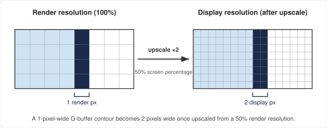
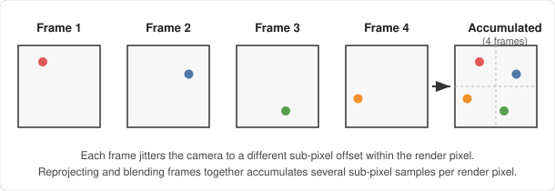

This post explains the core of my algorithm for drawing toon outlines from the G-buffer that are thinner than a
rendering pixel and stay crisp under a temporal upscaler. A G-buffer edge check can only say whether an edge passes
between two rendering pixels. But accumulated over the jittered frames of a temporal upscaler, those yes-or-no
answers pin the edge down to a line equation, accurate to a fraction of a pixel.

It is the first part of a [series](). The main post has the overview and the
links to the other parts.

Two terms I use throughout:

- a **rendering pixel** is a pixel of the renderer before the temporal upscaler;
- a **display pixel** is a pixel after it.

At 50% screen percentage, one rendering pixel covers 2×2 display pixels.

Where a formula is clearer as code, I quote the HLSL of my implementation, an Unreal Engine plugin. The code is at
<https://github.com/donguklim/thin-outline-plugin>.

## The Pixel-Thickness Problem

One common approach to toon-style outlines is to look for contours in the G-buffer. You compare depth, normal or
object-ID samples between neighbouring pixels, and flag an edge wherever the difference crosses a threshold.

Without a temporal upscaler, that works well. With one (TAAU, TSR, DLSS, FSR, XeSS), it runs into a problem.

These upscalers render the scene at a reduced internal resolution, set by the **screen percentage**. They then
reconstruct a full display-resolution image by accumulating frames over time.

A G-buffer contour algorithm is, at its core, an edge *detector*. For each rendering pixel, it answers one question:
"does a contour pass between this pixel and its neighbour?" The G-buffer only has samples at rendering resolution,
so the thinnest outline such an algorithm can draw is one rendering pixel wide. After upscaling, that is about
`1 / screen_percentage` display pixels: two at 50% screen percentage, four at 25%.



The usual compromises are:

- blurring the rendering-resolution outline by an amount that scales with the screen percentage, or
- supersampling the depth and normal data.

This algorithm does neither.

### How Temporal Upscalers Reconstruct Sub-Pixel Detail

A temporal upscaler builds up detail over several frames:

1. Each frame, the camera's projection is offset by a small **sub-pixel jitter**. The offsets usually come from a
   low-discrepancy sequence such as Halton, and together they cover the pixel evenly.
2. So frame *N* samples the scene at one position inside each rendering pixel, frame *N+1* at another, and so on.
3. The upscaler reprojects its history into the current frame with per-pixel motion vectors, and blends in the
   current frame's jittered sample.

After a handful of frames, the history holds several samples per rendering pixel.



This is why geometry-based outlines, such as an inverted hull, don't have the thickness problem. The outline mesh is
rasterized like any other triangle, at the frame's jitter. Its silhouette lands at a slightly different sub-pixel
position each frame, and the accumulation refines it.

A G-buffer detector's output is different. "Yes, this pixel is on a contour" is computed once per rendering pixel, on
a fixed grid. There is no continuous edge for the accumulation to refine: the history just receives several frames'
worth of the same yes. That mismatch is the root of the problem. A grid-locked detector feeds a system built to
accumulate continuous geometry.

## Reconstruct the Edge, Not Just Detect It

The algorithm goes one step further than detection: it reconstructs the line equation of the edge. The line is
expressed in the pixel's local coordinates, as a line crossing the pixel's square.

With that line, drawing the outline becomes geometry. Each pixel paints the band of the chosen thickness around the
line, with exact coverage. The thickness belongs to the line, not to the rendering-pixel grid. So it can be set
arbitrarily thin, even below a display pixel, and it stays the same at any screen percentage.

The rest of this post is about where the line comes from. In short:

1. A G-buffer check detects an edge only when the frame's jitter falls in a band around it
   ([What a G-Buffer Check Really Tests](#what-a-g-buffer-check-really-tests)).
2. Each pixel fits a line through the jitter positions on which its checks fired. It keeps running statistics
   instead of the samples ([Fitting the Band With a Temporal Record](#fitting-the-band-with-a-temporal-record),
   [What Each Pixel Records](#what-each-pixel-records), [Storing a Record](#storing-a-record)).
3. Each pixel pools its record with its two neighbours'
   ([Pooling a Pixel With Its Neighbours](#pooling-a-pixel-with-its-neighbours)).
4. The fit says how far it can be trusted ([The Fit and Its Reliability](#the-fit-and-its-reliability)), and each
   pixel picks one of its two candidate edges ([Choosing Between the Two Axes](#choosing-between-the-two-axes)).
5. Every pixel near the edge paints the part of the outline band inside it, with an alpha from the band's coverage
   ([Drawing Where the Band Crosses](#drawing-where-the-band-crosses), [Coverage-Based Alpha](#coverage-based-alpha)).

## What a G-Buffer Check Really Tests

Take the simplest G-buffer algorithm as an example. For a target pixel, it compares the depth or normal with that of
each of its four axial neighbours: up, down, left and right. If any neighbour differs by more than a threshold, the
target is marked as containing an outline.

### The Check Compares Two Jittered Samples

Here's the important part. The G-buffer is sampled at the frame's jittered position. So the check actually tests
whether an edge lies between the *jittered sample positions* of the target and its neighbour. It does not test the
pixels' centres or their full footprints.

Every pixel in a frame shares the same jitter offset. The two samples are therefore exactly one rendering pixel
apart, and the check detects whether an edge crosses the one-pixel segment between them.


### The Detectable Region Is a Parallelogram

Now take an actual geometric edge, and ask which jitter offsets would put it between two horizontally neighbouring
pixels. Those offsets form a **parallelogram**:

- two rendering pixels wide,
- running parallel to the edge,
- with the edge as its middle line.

If the frame's jitter offset falls inside the parallelogram, the check detects the edge between the two pixels.
Otherwise, it doesn't.


### The Left and Right Checks

Look at just the left and right comparisons. The edge splits the parallelogram into two halves, each one pixel wide:

- in the left half, a pixel's sample detects the edge when compared with its *right* neighbour;
- in the right half, it detects the edge when compared with its *left* neighbour.

I'll call these the pixel's **right check** and **left check**, after the neighbour they compare with. Together they
make up the pixel's **horizontal axis**. The top and bottom checks make up its **vertical axis**.


When the jitter falls outside the band, both samples of a pair land on the same surface, and the check finds nothing:


So, over many frames, the detected and not-detected jitter offsets of each check trace the shape of that check's half
of the parallelogram. And the parallelogram's middle line is the edge.

### The Checks I Use

My checks are a little more careful than "does the normal differ". They are still checks between a target pixel C and
an axial neighbour N, helped by the opposite neighbour O.

**The crease check** compares world-space normals. Its measure is

$$
\min\big(\,\lvert\, \mathbf n_C \times \mathbf n_N - \mathbf n_O \times \mathbf n_C \,\rvert,\ \lvert\, \mathbf n_C \times \mathbf n_N \,\rvert\,\big).
$$

This is the change of the normal toward N, minus the change from O to C where that is comparable. On a smoothly
curving surface, the two changes are similar and cancel, so only an abrupt bend counts. The check:

- is skipped across a depth discontinuity;
- fires when the measure exceeds a ridge or valley threshold (0.25 each by default);
- has a strength that rises linearly above the threshold and saturates at 1.

**The silhouette check** compares depths. Its measure is built from world positions and stays zero on a plane seen at
any angle; the [silhouettes]() post describes it. A pixel with a
silhouette toward any neighbour runs no crease checks at all.

Everything below applies to both kinds of check. Where silhouettes differ, their post says so.

**The sample position** is the same for every pixel of a frame. The engine's projection jitter moves the scene by the
jitter vector, so every pixel samples the G-buffer at the local position 0.5 minus this frame's jitter.

## Fitting the Band With a Temporal Record

The accumulated jitter offsets can be fitted with a statistical method, for example:

- [ordinary least squares](https://en.wikipedia.org/wiki/Ordinary_least_squares) regression (OLS), which finds the
  line running through the middle of the detected offsets;
- [linear discriminant analysis](https://en.wikipedia.org/wiki/Linear_discriminant_analysis), which finds the
  boundary between the detected and not-detected ones.

Either way, the estimate of the edge's position and orientation is far more accurate than any single frame's
one-pixel-wide detection. I use OLS. The rest of this post is about making it work.


### No Sample Has to Be Stored

This sounds like you need to store every sample point over the frames. You don't. OLS can be computed from
statistics accumulated over time, with decay, without keeping any sample position.

Work in the pixel's local coordinates:

- $u \in [0, 1]$ along the axis;
- $v \in [0, 1]$ across it.

Parametrize a line as $u = a + bv$. The edges an axis cares about run roughly across it, so solving for $u$ as a
function of $v$ avoids near-vertical slopes.

Given samples $(u_i, v_i)$, the OLS fit is

$$
b = \frac{\sigma_{uv}}{\sigma_v^2}, \qquad a = \mu_u - b\,\mu_v,
$$

where $\mu$ are the means, $\sigma_v^2$ is the variance of $v$, and $\sigma_{uv}$ is the covariance of $u$ and $v$.
These, plus the variance of $u$ for the standard errors later, are everything a record has to hold.

## What Each Pixel Records

### One Pixel's Samples Form a Trapezoid

My first design merged the samples of neighbouring pixels, since one edge's parallelogram spans two of them. That
breaks down as soon as two edges are less than two pixels apart. More than two consecutive pixels then hold samples
of the same check, and there is no telling which samples belong to which edge.


The solution is simple: don't merge. Each rendering pixel applies OLS on its own, using only its own jitter samples.
The pixel boundary cuts the parallelogram, and the pixel fits a line through the middle of the resulting
**trapezoid**, not through the middle of the whole parallelogram.


### Decoding the Edge From the Trapezoid

The trapezoid's midline still gives the edge back, with simple algebra.

Write the edge in the pixel's coordinates as $u = E(v) = A + Bv$. The left check fires when the edge lies between the
left neighbour's sample at $u - 1$ and the pixel's own sample at $u$. Inside the pixel, that means
$u \in [E(v),\ 1]$. So at each height $v$, the detected samples run from $E(v)$ to 1, and their midpoint is
$(1 + E(v))/2$.

The line through all those midpoints is

$$
u = \frac{1 + A + Bv}{2} = \underbrace{\frac{1 + A}{2}}_{a} + \underbrace{\frac{B}{2}}_{b}\,v,
$$

so the fitted $a$ and $b$ decode to the edge as

$$
A = 2a - 1, \qquad B = 2b .
$$

In my first design, each pixel then used the decoded $A$ to decide whether it *contained* the edge, and only the
containing pixel drew. The algorithm now does something else, described under
[Drawing Where the Band Crosses](#drawing-where-the-band-crosses). The decoding above is used as it is.

### Using Both Checks of an Axis

Recording only the left check's samples throws information away.

For the pixel that contains the edge, the frames on which the left check did *not* fire are exactly the frames on
which the right check did. A sample at $u < E(v)$ lies on the other side of the edge from the left neighbour's
sample, but on the same side as the pixel's own. Now it is the right neighbour's sample that sits across the edge.
Ignoring the boundary itself, "not detected by the left check" and "detected by the right check" are the same set of
samples.


The right check's samples fill the complementary trapezoid, $0 \le u < E(v)$. Its midline is
$E(v)/2 = a + bv - \tfrac12$: the left check's midline, shifted by exactly half a pixel.


So one record per axis is enough, with both checks folded into it:

- a sample that fired the left (or top) check is recorded as it is, at $(u, v)$;
- a sample that fired the right (or bottom) check is first shifted half a pixel along the axis, and recorded at
  $(u + \tfrac12, v)$.

Both land on the same midline, $u = \tfrac12 + E(v)/2$, and the record fits that midline from twice the samples.

A frame on which neither check fires records nothing. The record is left alone, so a pixel far from any edge stays
empty. The sample count itself tells how often the pixel sees the edge.

### One Edge's Samples Live in Three Pixels

Folding both checks into one record also means that the record uses the full data of both parallelograms next to the
pixel, not half of each.

Take an edge in pixel B, with neighbours A and C. The horizontal axis has two parallelograms: one straddles the A–B
boundary, the other the B–C boundary.


The pixel boundaries cut them into four trapezoids, but there are only two distinct sets of samples. A's right check
and B's left check are literally the same comparison between the same two samples. So A's right trapezoid holds the
same frames as B's left trapezoid. The same goes for C and B on the other side.


Keep that picture in mind: **one edge's samples live in three pixels**. The edge pixel holds both halves, and each
neighbour holds a copy of one half. This is what makes the pooling further down work.

### One Record per Axis, Crease or Silhouette

A pixel's axis record is either a crease record or a silhouette record, never both. The type is stored in the sign of
the sample count.

- A silhouette sample always takes over a crease record.
- A crease sample takes over a silhouette record only once the silhouette record has nearly faded away.

The [silhouettes]() post gives the rules, and why the takeover
threshold has to sit below one sample. Everything below treats a record as typeless statistics.

## Storing a Record

Each record holds:

- a decayed sample count $n$;
- the means $\mu_u, \mu_v$;
- the variances $\sigma_u^2, \sigma_v^2$ and the covariance $\sigma_{uv}$;
- the mean edge strength;
- a presence value, which the [flicker suppression]()
  post explains.

That is two RGBA16F texels per axis. With the extra per-axis data that silhouettes need, my implementation stores 44
bytes per rendering pixel. It keeps them twice: once for this frame and once for the history.

Three storage decisions turned out to matter.

### Central Moments

My first design stored raw running averages ($\langle u\rangle$, $\langle u^2\rangle$, $\langle uv\rangle$ and so
on) and computed the variance as $\langle u^2\rangle - \langle u\rangle^2$. In fp16, that is a difference of two
nearly equal numbers:

- Half floats keep 11 significant bits.
- In these records, $u$ reaches about 1.5 after the half-pixel shifts. There $\langle u^2\rangle \approx 2$, and one
  fp16 step is about $10^{-3}$.
- Every frame's store rounds by up to half a step, while the variance being measured may be $10^{-3}$ or smaller.

I simulated 400 frames of samples through both schemes, rounding to fp16 after every frame as a texture store would,
with a decay rate of 0.04:

| Band of samples | Exact variance | Raw moments in fp16 | Central moments in fp16 |
|---|---:|---:|---:|
| width 1.0 around u = 0.6 | 0.058672 | 0.058315 (1% off) | 0.058655 (0.0% off) |
| width 0.2 around u = 1.4 | 0.003610 | 0.000266 (**93%** off) | 0.003571 (1.1% off) |
| width 0.05 around u = 1.4 | 0.000218 | −0.000748 (**negative**) | 0.000218 (0.1% off) |

Narrow bands are exactly the slivers next to pixel boundaries, where the standard errors matter most.

So the records hold **central moments**: the mean, and the variances and covariance about it. These keep small
numbers small.

Central moments also make moving a record trivial. Shifting all the samples by a constant changes only the mean. So
the half-pixel shifts above, and the shifts of the history reprojection, touch $\mu$ and leave the moments alone.

### A New Sample Weighs One Over n

The classic decayed average, $\langle v\rangle \leftarrow (1-d)\langle v\rangle + d\,v$, starts biased toward zero.
After one sample it holds $0.04\,v$, and after 17 only about $v/2$. Every freshly reset record would start wrong. And
since the moments are biased by different amounts, its variance would be wrong too.

Instead, $n$ is incremented first, and the new sample gets the weight $\alpha = 1/n$:

- the first sample is taken at full value;
- from then on, the record is the exact weighted mean of what it has seen;
- with a sample every frame, $n$ settles at $1/d$ and $\alpha$ at $d$, which is the classic update.

The mean and the central moments update together:

$$
\boldsymbol\delta = \mathbf s - \boldsymbol\mu, \qquad
\boldsymbol\mu \leftarrow \boldsymbol\mu + \alpha\,\boldsymbol\delta, \qquad
\Sigma \leftarrow (1-\alpha)\left(\Sigma + \alpha\,\boldsymbol\delta\boldsymbol\delta^\top\right),
$$

where $\mathbf s$ is the new sample and $\Sigma$ is the covariance matrix of $(u, v)$. In the shader, the record's
extra per-sample values are updated as plain weighted means:

```hlsl
// Exponentially weighted update of the running mean and central moments with one new sample of weight 1.
void AddRecordSample(inout FThinOutlineRecord Record, float2 Sample, float Strength)
{
	Record.SampleCount += 1.0;
	const float Alpha = rcp(Record.SampleCount);
	const float2 Delta = Sample - Record.Mean;

	Record.Mean += Alpha * Delta;
	Record.Variance = (1.0 - Alpha) * (Record.Variance + Alpha * Delta * Delta);
	Record.Covariance = (1.0 - Alpha) * (Record.Covariance + Alpha * Delta.x * Delta.y);
	Record.Strength += Alpha * (Strength - Record.Strength);
}
```

### The Count Decays Every Frame

Every frame, with or without a sample, $n \leftarrow (1-d)\,n$. The means and moments are normalized, so this leaves
them unchanged. It only shrinks the weight of everything recorded so far.

The decay rate is 0.04 by default, a memory of about 25 frames. A record whose count falls below 0.1 is cleared.

Decaying every frame, not only on frames with a sample, is what makes $n$ mean "how often". A record that gets a
sample on a fraction $f$ of the frames settles at $n \approx f/d$. For example:

- a pixel on the edge gets a sample every frame;
- its two neighbours each get the frames on one side of the edge, so their counts add up to the edge pixel's, in the
  right proportions.

The pooling in the next section weights records by $n$. Only this decay rule makes that weight the weight of the
actual samples.

It also makes stale records fade. If an edge moves away and the history is not rejected, its record decays below the
three-sample minimum in about 50 frames and is cleared after about 135.

## Pooling a Pixel With Its Neighbours

### The Dashed-Line Artifact

With one record per pixel and axis, the pixel containing the edge fits a line from both halves of the edge's samples.
Each neighbour fits a one-sided copy.

In my first implementation, this asymmetry showed up as an artifact when the true edge sat close to a pixel boundary.
Statistical noise could make a pixel conclude that it doesn't contain the edge. Its neighbour, working from different
data, could conclude the same, or the opposite.


A mostly horizontal edge crosses row after row of pixels near their boundaries. Along such an edge, the contour kept
thickening to two pixels or dropping out: a dashed outline.


The artifact has two causes:

1. Neighbouring pixels fit **different data**, so they can disagree about where the edge is.
2. Only the pixel that **contains** the edge drew, so a disagreement cost a whole segment rather than a little
   thickness.

The algorithm removes both. This section removes the first, and
[Drawing Where the Band Crosses](#drawing-where-the-band-crosses) the second.

### Why Neighbours Can Share Their Records

Neighbouring pixels can fit the same data because, as shown above, the edge pixel's record is already duplicated
piece by piece in its two neighbours:

- B holds L1 and R1;
- A holds a copy of R1;
- C holds a copy of L1.

The records are only stored in different coordinates. So a neighbour's record must first be shifted into the reading
pixel's coordinates.


**First, each pixel's own shift.** Each pixel folds its samples into its record with the rule above: left-check
samples as they are, right-check samples shifted half a pixel.

- For B, R1 is a left-check detection and stays. L1 is a right-check detection and moves half a pixel right, on top
  of R1.
- For A, R2 is a right-check detection, so A shifts it half a pixel right too, past A's own right boundary.
- For C, L2 is a left-check detection and stays.


**Then, aligning the neighbours.** A's right check fires on exactly the same frames as B's left check, at the same
local jitter position, since every pixel shares the jitter. B kept those samples where they were; A shifted them half
a pixel right. So for every sample they share, A's stored $u$ is half a pixel greater than B's. Shifting A's record by
$-\tfrac12$ lays it on top of R1. C mirrors this: shifting C's record by $+\tfrac12$ lays it on B's shifted L1.


**Why half a pixel.** The neighbours sit a full pixel away, but the shift is half a pixel, because the records don't
store raw positions. They store positions folded into each pixel's trapezoid, whose far side is pinned to the pixel's
own boundary. The midline is $\tfrac12 + E(v)/2$, so moving the edge by a whole pixel moves the midline by half.

The rule, from any pixel's point of view:

- a neighbour one pixel to the left (or above) is shifted by $-\tfrac12$ along the axis;
- a neighbour to the right (or below) is shifted by $+\tfrac12$;
- nothing moves across the axis.

With central moments, the shift is a single subtraction from the mean:

```hlsl
// Re-expresses a record in the local coordinates of a pixel whose origin is at Offset = (along, across) in the
// record's coordinates. u stores trapezoid midlines, whose far side is pinned to the pixel boundary, so it moves
// at half rate.
void ShiftRecord(inout FThinOutlineRecord Record, float2 Offset)
{
	Record.Mean -= float2(0.5 * Offset.x, Offset.y);
}
```

### Pooling Instead of Fitting the Neighbours Alone

#### The Neighbours-Only Fit

My first implementation drew the strict conclusion from this: each pixel fits only its two neighbours' shifted
records, never its own. Then:

- B fits A's R2 and C's L2, which are R1 and L1;
- A fits B's record, which is L1 and R1;
- C fits B's record too.

All three fit exactly the same samples and decode the same line. Pooling a pixel's own record in as well seemed wrong:
A would count R1 twice, and C would count L1 twice. The dashed-line artifact appears exactly where that difference is
largest in relative terms, with the edge a sliver from the boundary.

But "exactly the same data" only holds while all three histories agree. Suppose the reprojection rejects one pixel's
history, say because the pixel was just disoccluded. Its record restarts with a handful of samples while its
neighbours' records are full, and the three pixels fit different data again.

My first implementation guarded against this with a reliability test on each neighbour. When a neighbour failed, the
pixel fell back to its own record. But that guard is itself a yes-or-no decision. A freshly reset pixel whose
neighbour was reset too fell back to its own invalid record, and drew nothing.

#### The Pool

So now each pixel **pools its own record with both neighbours'**, weighted by their sample counts, with no
reliability switch:

![Three square pixels A, B and C in a row with a nearly vertical black edge inside B. A's right portion is shaded blue, B's left portion orange and right portion blue, and C's left portion orange, showing where each pixel's samples come from. Below the pixels, three record boxes labeled with the sample counts n_A, n_B and n_C are joined by arrows into one pool box under B. The arrow from A is labeled "shift −½ along the axis", the arrow from B "as is", and the arrow from C "shift +½". The pool box reads: weighted by n_A, n_B, n_C, then OLS fit, and an arrow from it points back up to the edge in B](/assets/images/thin-outline/pooled-merge.svg)

For a pixel $p$, take the records of the pixels $p + k$ along the axis, $k \in \{-1, 0, 1\}$. First, each record is
moved into $p$'s coordinates, $\tilde{\boldsymbol\mu}_k = \boldsymbol\mu_k + (\tfrac k2,\ 0)$, with $\Sigma_k$
unchanged. Then the non-empty records are pooled:

$$
n = \sum_k n_k, \qquad
\boldsymbol\mu = \frac1n \sum_k n_k\,\tilde{\boldsymbol\mu}_k, \qquad
\Sigma = \frac1n \sum_k n_k \left(\Sigma_k + (\tilde{\boldsymbol\mu}_k - \boldsymbol\mu)(\tilde{\boldsymbol\mu}_k - \boldsymbol\mu)^\top\right).
$$

That is the pooled mean and the law of total variance. Weighted by $n$, the pool's statistics are exactly the mean
and covariance of the union of the three records' samples, each sample keeping its decay weight. Weighting by $n$
matters for two reasons:

- any other weighting gives a covariance that describes no actual set of samples, and the standard errors built from
  it lose their meaning;
- a just-reset record has a small $n$, and therefore little say, without any threshold deciding when it starts to
  count.

In the shader, the pool is built by merging the records one after another:

```hlsl
// Statistics of the union of the samples of two records (expressed in the same coordinates).
FThinOutlineRecord MergeRecords(FThinOutlineRecord Record0, FThinOutlineRecord Record1)
{
	FThinOutlineRecord Merged;
	Merged.SampleCount = Record0.SampleCount + Record1.SampleCount;

	const float Weight0 = Merged.SampleCount > 0.0 ? Record0.SampleCount / Merged.SampleCount : 0.0;
	const float Weight1 = 1.0 - Weight0;

	Merged.Mean = Weight0 * Record0.Mean + Weight1 * Record1.Mean;

	const float2 Delta0 = Record0.Mean - Merged.Mean;
	const float2 Delta1 = Record1.Mean - Merged.Mean;
	Merged.Variance = Weight0 * (Record0.Variance + Delta0 * Delta0) + Weight1 * (Record1.Variance + Delta1 * Delta1);
	Merged.Covariance = Weight0 * (Record0.Covariance + Delta0.x * Delta0.y) + Weight1 * (Record1.Covariance + Delta1.x * Delta1.y);
	Merged.Strength = Weight0 * Record0.Strength + Weight1 * Record1.Strength;
	return Merged;
}

// AlongOffset: this pixel's origin along the axis, in the record's coordinates.
void PoolRecord(inout FThinOutlineRecord Pooled, FThinOutlineRecord Record, float AlongOffset)
{
	if (Record.SampleCount > 0.0)
	{
		ShiftRecord(Record, float2(AlongOffset, 0.0));
		Pooled = MergeRecords(Pooled, Record);
	}
}
```

#### What the Pool Gives Up

The pool has two costs:

- In steady state, the three pixels no longer fit exactly the same samples. For an edge in B, A pools L1 and two
  copies of R1, while B pools two copies of each.
- The pool counts shared samples twice. Its sample count can overstate the information by up to a factor of two, and
  the standard errors come out up to $\sqrt2$ too small.

I accepted both because of the drawing rule further down: every pixel paints its share of the band, not only the
containing pixel. Then a small disagreement between neighbours costs a little thickness, not a whole segment.

A synthetic test makes that concrete. Give every pixel's fitted edge position an independent random error of
standard deviation $\sigma$. Then count, per column of a straight crease, how often the drawn outline is under half
the true amount (a gap) or over one and a half times it (a double). For a one-display-pixel outline at 100% screen
percentage:

| Position error σ (px) | Containment: gap / double | Band painting: gap / double |
|---:|---|---|
| 0.05 | 3.0% / 0% | **0% / 0%** |
| 0.1 | 5.7% / 0% | **0% / 0%** |
| 0.2 | 8.2% / 0.8% | 0.5% / 1.8% |
| 0.3 | 9.5% / 5.0% | 5.0% / 9.8% |

Small disagreements cost containment whole segments, and cost band painting nothing. So pixels near an edge still
need to fit *nearly* the same data, but no longer *exactly* the same. That is what the pool gives.

Two more results:

- A second synthetic test resets the history of 20% of the pixels a few frames before measuring, with the
  11-position jitter sequence that TSR uses at 100% screen percentage. The neighbours-only fit with its fallback left
  gaps in 11.4% of the columns; the pool left none.
- On the GPU, with a static camera, a near-horizontal crease that had come out dashed became nearly continuous.
  Diagonal and vertical creases were unchanged.

### What Happened to the Co-Trigger Ratio

The pooling above assumes that a single edge crosses the pixel along the axis. With two edges less than a pixel
apart, a sample landing on the sliver between them fires both checks of the axis in the same frame.

My first design kept a decayed count of these **co-trigger** frames per record, and used the ratio as a reliability
signal:

- co-triggered records were left out of the fit;
- an axis whose own record was co-triggered was treated as having no edge.

In practice, that produced dashed outlines, most visibly in scenes with many buildings when drawing after the
upscaler. So I turned the rule off, and then removed the ratio altogether. Its channel now holds the "presence" value
used against flickering artifacts.

Dense edges are now handled after the fit, by the dense edge suppression described in the
[flicker suppression]() post.

## The Fit and Its Reliability

### Standard Errors

The pooled record goes into the OLS formula above. The fit also says how much it can be trusted: the standard errors
say how much the slope and the line's position would wobble if the same edge were sampled again with different
jitter.

With $n$ the sample count, the residual variance (the scatter of the samples around the fitted line) is

$$
s^2 = \frac{n}{n-2}\left(\sigma_u^2 - \frac{\sigma_{uv}^2}{\sigma_v^2}\right),
$$

and the standard error of the slope follows from it:

$$
\mathrm{SE}(b) = \frac{s}{\sqrt{n\,\sigma_v^2}} .
$$

Instead of the intercept's standard error, I compute the standard error of the line's position at the pixel's
centre, $v = \tfrac12$. That is the least uncertain point of the line, and it is uncorrelated with the slope:

$$
\mathrm{SE}(E(\tfrac12)) = 2\,s\,\sqrt{\frac1n\left(1 + \frac{(\tfrac12 - \mu_v)^2}{\sigma_v^2}\right)}.
$$

It is doubled, like the decoded edge. The spatial filter and the dense edge suppression compare neighbouring pixels
through it.

A fit is **valid** only when both of these hold:

- it has at least three samples, since two points always fit a line exactly;
- the spread of $v$ is above $10^{-4}$. The samples are spread over the pixel's height, and a record with less spread
  has nothing to say about the slope.

### Counting Distinct Jitter Positions

The standard errors assume $n$ independent samples. A temporal jitter sequence is not independent: TSR cycles through
$L$ positions and then repeats them in the same order. At 100% screen percentage $L = 11$; at 50% it is 37. That
broke the statistics in a way I only found with a GPU dump.

#### The Stray Dots

At 100% screen percentage, a diagonal crease in my test level came out dotted. A second, broken line of dark pixels
sat just below it, in every second row. At 50%, the same crease was clean.

The stray pixels had no record of their own. Each drew the line of its upper neighbour's record, a sliver record
below the edge, with:

- $n = 4.94$;
- a slope of $-2.37$ in its axis, against a true slope of about $+0.55$;
- a standard error of **exactly zero**.

The record's statistics had a correlation of $-1.000$: every sample it held lay on one line. Samples spread over a
region can only do that if there are just two distinct ones. Reading the 11 jitter positions off the sequence,
exactly two of them land in that sliver. So every 11 frames, the record added the same two points again.

Its decayed count climbed to about 5, but its information was that of 2 points. Two points fit a line perfectly,
which gave the most confident possible verdict about a meaningless slope.

![A single square pixel with its top edge marked as the boundary to the pixel above. A black line, the true edge decoded from the pixel above, enters at the top near the left and leaves through the right side below the middle, and the light blue sliver between the top edge and this line is the only region where the pixel's top check fires. Eleven small dots mark the jitter positions of TSR's 11-frame sequence spread over the pixel; nine are gray and outside the sliver, and two, in the sliver's right part, are red. A red dashed line runs through the two red dots, far steeper than the black edge and tilted the other way, labeled as the fitted line through the only two recorded positions with zero residual and a standard error of zero](/assets/images/thin-outline/two-point-fit.svg)

The record's data was correct. What was wrong was how much it was trusted.

#### The Distinct Sample Count

The fix is to give the standard errors an estimate of how many *distinct* jitter positions the record holds, instead
of how many frames.

A record that receives a sample on a fraction $f$ of the frames settles at $n \approx f/d$. If its memory of about
$1/d$ frames spans at least one cycle, it holds all $fL$ distinct positions of that fraction. So

$$
n_{\text{distinct}} = n\,d\,L = n \cdot \min(1,\ dL).
$$

The minimum covers the other case: a memory shorter than a cycle never sees a position twice, so all its samples are
distinct.

Nothing extra is recorded per pixel. The scale is one number per view per frame, with $L$ read from the engine's
jitter sequence length. The shader multiplies the sample count by it before computing the fit's validity and
standard errors. With the default decay:

| Screen percentage | L | min(1, 0.04 L) |
|---:|---:|---:|
| 100% | 11 | 0.44 |
| 75% | 17 | 0.68 |
| 67% | 19 | 0.76 |
| 50% | 37 | 1.00 |
| 25% | 131 | 1.00 |

#### Checking the Fix

Against the dumped records of that frame, the estimate matched the distinct positions read off the jitter table:

| Record | n | n × 0.44 | Distinct positions |
|---|---:|---:|---:|
| The sliver record | 4.94 | 2.17 | 2 |
| The edge pixel | 24.63 | 10.84 | 11 |
| The pixel above the edge | 19.66 | 8.65 | 9 |

I re-ran the composite in Python on the dumped records with the scaled count, and every stray dot was gone before a
line of shader was changed. A sweep over six slopes, twenty sub-pixel offsets and both sequence lengths found no
stray pixel with the fix.

One effect remains at $L = 11$: lines of one slope sign are drawn about 0.1 pixels off. The 11-point Halton set is
not mirror-symmetric, and mirroring the jitter moves the error to the other sign. It is a property of fitting lines
to a short, lopsided point set, and it is gone from 50% screen percentage on.

The whole fit, in the shader:

```hlsl
// DistinctSampleScale converts the decayed sample count into the number of distinct jitter positions behind it, which is
// what the sample count of the standard errors has to be: repeated positions add no information, and a record of only
// two distinct positions fits a line exactly, with a zero standard error.
FThinOutlineEdgeFit FitEdge(FThinOutlineRecord Record, float DistinctSampleScale)
{
	FThinOutlineEdgeFit Fit = (FThinOutlineEdgeFit)0;

	const float SampleCount = Record.SampleCount * DistinctSampleScale;
	Fit.bValid = SampleCount >= THIN_OUTLINE_MIN_FIT_SAMPLE_COUNT && Record.Variance.y > THIN_OUTLINE_MIN_FIT_VARIANCE;
	if (!Fit.bValid)
	{
		return Fit;
	}

	const float B = Record.Covariance / Record.Variance.y;
	const float A = Record.Mean.x - B * Record.Mean.y;

	const float ResidualVariance = max(Record.Variance.x - Record.Covariance * B, 0.0) * SampleCount / (SampleCount - 2.0);
	Fit.SlopeStandardError = sqrt(ResidualVariance / (SampleCount * Record.Variance.y));
	const float CenterOffset = 0.5 - Record.Mean.y;
	Fit.CrossingStandardError = 2.0 * sqrt(ResidualVariance / SampleCount * (1.0 + CenterOffset * CenterOffset / Record.Variance.y));

	// The record fits the trapezoid midline u = 0.5 + E / 2.
	Fit.Intercept = 2.0 * A - 1.0;
	Fit.Slope = 2.0 * B;
	return Fit;
}
```

## Choosing Between the Two Axes

Each pixel reconstructs up to two edges, one from its horizontal axis and one from its vertical axis, and draws one
of them. Three rules decide which.

**The type comes first.** Silhouette candidates are considered first. Crease candidates count only when neither axis
has a silhouette.

**Then the stability.** Between two candidates of the same type, the slope standard errors decide. If they differ by
more than a threshold (0.05 by default), the edge with the smaller one is clearly the more stable fit, and wins:

$$
\big|\,\mathrm{SE}(b_h) - \mathrm{SE}(b_v)\,\big| > \tau_{\text{SE}}
\;\Longrightarrow\;
\text{pick the smaller } \mathrm{SE}(b) .
$$

**Then the slope.** Otherwise, both are about equally stable, and the slope breaks the tie. Each axis sees an edge
best when the edge crosses it squarely. Each edge's slope is already measured against its own axis, so the better
match is the one with the smaller absolute slope:

$$
\big|\,\mathrm{SE}(b_h) - \mathrm{SE}(b_v)\,\big| \le \tau_{\text{SE}}
\;\Longrightarrow\;
\text{pick the smaller } |b| .
$$

Why the slope's standard error, and not the position's? An unstable position only slides the line within the pixel.
An unstable slope means the pixel doesn't know which way the edge runs. That is a much stronger sign that the pixel is
looking through the wrong axis.

The [spatial filters]() post adds one more step, which runs on
the chosen edge before it is drawn.

## Drawing Where the Band Crosses

### Every Pixel Near the Edge Knows the Same Line

My first design had each pixel decide whether it *contains* the reconstructed edge, and only the containing pixel
drew. But the decoding $E(v) = 2(a + bv) - 1$ works just as well for the pixel's neighbours, and that makes a
different rule possible.

Take one row and the horizontal axis. Say the edge is at $u = E$ in a pixel's coordinates. Then it is at $E + 1$ in
its left neighbour's coordinates, and at $E - 1$ in its right neighbour's. Each pixel's checks record:

- the left check: $u$, when the edge lies in $[u - 1, u)$;
- the right check: $u + \tfrac12$, when the edge lies in $[u, u + 1)$.

| Edge position in this pixel | Left check samples | Right check samples, shifted | Mean of the recorded u |
|---|---|---|---|
| E in [−1, 0], edge in the left neighbour | u in [0, E + 1), mean (E + 1) / 2 | none | 1/2 + E/2 |
| E in [0, 1], edge in this pixel | u in [E, 1], mean (E + 1) / 2 | u in [0, E) + 1/2, mean E/2 + 1/2 | 1/2 + E/2 |
| E in [1, 2], edge in the right neighbour | none | u in [E − 1, 1) + 1/2, mean E/2 + 1/2 | 1/2 + E/2 |

So for every pixel within one pixel of the edge, the expected recorded $u$ at height $v$ is $\tfrac12 + E(v)/2$,
with $E(v)$ anywhere in $[-1, 2]$.

When the edge is straight, that is linear in $v$. OLS recovers it, and the decoding gives the edge back: the edge
pixel finds $E$, its left neighbour $E + 1$, and its right neighbour $E - 1$. **The same line, each in its own
coordinates.** With the pooled records, the neighbours also fit nearly the same samples, so in practice they agree
closely.

### The Band Test

That makes a purely geometric drawing rule safe: **every pixel paints the part of the outline band that lies inside
its own square**, whether or not the edge itself passes through it. The band is the edge widened to the outline's
thickness.

Containment is not enough, for two reasons:

1. **A slanted edge crosses more than one pixel per row.** With the horizontal axis, the edge moves sideways by the
   slope over a row's height. Even a slope of 0.5 puts it in two pixels of the same row for part of their height.
2. **The outline has a thickness.** Even a perfectly vertical edge near a pixel boundary has its band spill into the
   neighbour. A one-display-pixel outline at 100% screen percentage is a full rendering pixel wide, so most edges
   touch two pixels per row.

In both cases, a pixel that doesn't contain the edge has to draw part of it. It can, because it knows the same line.

![Two panels, each a grid of five columns and two rows of square pixels with the same black edge running from the top row at the left down into the bottom row at the right, and a gray band around the edge marking the outline's thickness. In the upper panel, labeled containment test, only the pixel in each column whose center line the edge crosses is filled with the band: the band is painted in the top row for the first two columns and in the bottom row for the last three, and where the band spills across the row boundary, at the right end of the second column and the left end of the third, the spilled parts are shown only as a dashed outline, leaving notches in the drawn line. In the lower panel, labeled band test, every pixel is filled with the part of the band inside its own square, and the band is continuous across the grid](/assets/images/thin-outline/band-crossing-rule.svg)

A pixel's sample is always inside its own square, so every piece of the band is drawn by exactly one pixel. The line
has no gaps or doubled segments.

**The band test runs before the axis choice.** At a corner of two creases, the horizontal edge may cross the pixel
while the vertical one passes just outside. Choosing first could pick the vertical edge on its slope standard error,
and then draw nothing. So only edges that reach the pixel compete.

**What the rule changes.** A simulation of a straight crease with slope 0.5 at 50% screen percentage shows it. The
numbers are the outline alpha times ten, for the same rows and the same records:

```
center containment                       band test                                true coverage
  7  9  0  0  0  0  0  0  0  0             7  9  4  1  0  0  0  0  0  0             6  9  5  1  0  0  0  0  0  0
  0  0  7  9  0  0  0  0  0  0             0  2  7  9  4  1  0  0  0  0             0  1  6  9  5  1  0  0  0  0
  0  0  0  0  7  9  0  0  0  0             0  0  0  2  7  9  4  1  0  0             0  0  0  1  6  9  5  1  0  0
  0  0  0  0  0  0  7  9  0  0             0  0  0  0  0  2  7  9  4  1             0  0  0  0  0  1  6  9  5  1
```

With containment, each column draws only the pixel whose centre line the edge crosses, and the band's share in the
next row is lost. The line comes out thinner and uneven, with a staircase of missing pieces. The band test reproduces
the true coverage within about 0.1.

**The price.** A containment test is forgiving. An unreliable neighbour fit whose line only clips a corner of the
pixel is ignored, because its decoded position falls outside. The band test draws whatever a fit says crosses the
pixel, which is exactly how the stray dots above showed up. So the band test needs fits that are honest about their
reliability, and the distinct sample count provides that.

## Coverage-Based Alpha

Each check gives its detection a strength, not just a yes or no, and the record keeps the mean strength of its
samples. That strength, times the band's **coverage** of the pixel, is the alpha by which the pixel's colour is
blended toward the outline colour.

### Why Coverage, Not a Hit Test

The reason comes from how the upscaler accumulates.

My first drawing shader decided each frame's alpha by point sampling. If the frame's jittered sample fell within the
band, the pixel passed its strength; otherwise it passed zero. The upscaler was left to average the hits and misses
into a smooth outline.

That fails for thin outlines. An outline thinner than a display pixel is hit by only a few jitter positions. So each
display pixel saw it on only a few frames, the history had too few hits to hold on to, and the outline faded and
blinked.

![Three frames of the same render pixel at 50% screen percentage, divided into 2 by 2 display pixels, with a slanted outline band crossing it. In frame 1 the jittered sample lands in the top-left display pixel inside the band, and an arrow leads to a fully black painted result. In frame 2 the sample lands in the same top-left display pixel but outside the band, and the painted result is blank. In frame 3 the sample lands inside the band in the bottom-right display pixel, which the band barely touches, and the painted result is again fully black](/assets/images/taa-toon-outline/coloring-hit-based.svg)

The better rule gives each display pixel the same answer every frame, whatever the jitter. Given the frame's sample
position, find the display pixel $D$ it falls in and the rendering pixel $R$ it belongs to, and pass

$$
\alpha = s \cdot \frac{\lvert\, \text{band} \cap D \cap R \,\rvert}{\lvert\, D \cap R \,\rvert},
$$

with $s$ the strength. This is the band's share of the part of the display pixel that lies inside this rendering
pixel. Clipping to $R$ matters when a display pixel straddles rendering pixels, as it does at 67% screen percentage.

**Why it averages to the exact coverage.** Among the samples landing in $D$, a sample lands in $D \cap R$ with
probability $\lvert D \cap R\rvert / \lvert D\rvert$. So the upscaler's average for $D$ is

$$
\sum_{R} \frac{\lvert D \cap R \rvert}{\lvert D \rvert} \cdot \frac{\lvert \text{band} \cap D \cap R \rvert}{\lvert D \cap R \rvert}
= \frac{\lvert \text{band} \cap D \rvert}{\lvert D \rvert},
$$

the exact coverage of the display pixel. This holds as long as all the rendering pixels overlapping $D$ draw the same
line, which is again the property that neighbours decode the same line.

![Four frames of the same render pixel at 50% screen percentage, divided into 2 by 2 display pixels labeled with their outline coverage: 50% top-left, 0% top-right, 36% bottom-left, 14% bottom-right. In frames 1 and 2 the jittered sample lands in the top-left display pixel, once inside the band and once outside, and both arrows lead to the same 50% gray result. In frame 3 the sample lands inside the band in the bottom-right display pixel and paints a lighter 14% gray. In frame 4 the sample lands in the top-right display pixel, which the band doesn't reach, and paints blank](/assets/images/taa-toon-outline/coloring-coverage-based.svg)

### Computing the Band's Area

The areas are computed in closed form. Work in the axis coordinates, with the edge $u = A + Bv$. Take a rectangle
$[u_0, u_1] \times [v_0, v_1]$ and a line $u = c + Bv$. The part of the rectangle on one side of the line is a
one-dimensional integral of a clamped ramp:

$$
\operatorname{area}\{u - Bv \le c\} = \int_{v_0}^{v_1} \operatorname{clamp}\!\big(g(v),\ 0,\ W\big)\, dv,
\qquad g(v) = c + Bv - u_0, \qquad W = u_1 - u_0.
$$

Here $g(v)$ is how far the line lies to the right of the rectangle's left side at height $v$. The clamp cuts it off
at the rectangle's two sides.

Since $\operatorname{clamp}(g, 0, W) = \max(g, 0) - \max(g - W, 0)$, the integral splits into two integrals of
$\max(g, 0)$ for a linear $g$. Each has three cases: both ends non-negative, both non-positive, or a crossing in
between.

The band is the difference of two such half planes, at $c = A \pm t\sqrt{1 + B^2}$, for a half thickness $t$
measured perpendicular to the edge. The factor is there because a perpendicular distance $t$ spans
$t\sqrt{1 + B^2}$ along the $u$ axis:

![One rendering pixel drawn as a square in axis coordinates, u to the right and v down, with dashed lines at 0.6 marking the display pixel grid of 60% screen percentage. The display pixel under this frame's sample is outlined dashed and extends past the rendering pixel's right side; its part inside the rendering pixel is shaded light blue and labeled with u0, u1, v0 and v1. A black edge line u = A + Bv runs from the top of the square down and to the right, with a gray band around it between the lines u = c minus plus Bv and u = c plus plus Bv, and the part of the band inside the shaded rectangle is darker. A right triangle is drawn between the edge and the band's right boundary: a horizontal blue segment along u from a point on the edge to the boundary, labeled c plus minus A equals t times the square root of 1 plus B squared; a red segment from the same edge point perpendicular to the edge, labeled t; and a gray segment along the boundary line closing the triangle, with a right-angle mark where the red and gray segments meet](/assets/images/thin-outline/coverage-example.svg)

```hlsl
// Integral over Length of max(g, 0), with g linear from G0 to G1.
float IntegrateRamp(float G0, float G1, float Length)
{
	const float GMin = min(G0, G1);
	const float GMax = max(G0, G1);

	if (GMin >= 0.0)
	{
		return Length * 0.5 * (G0 + G1);
	}
	if (GMax <= 0.0)
	{
		return 0.0;
	}
	return Length * 0.5 * GMax * GMax / (GMax - GMin);
}

// Area of {(u, v) in [RectMin, RectMax] : u - Slope * v <= Offset}.
float GetHalfPlaneArea(float Offset, float Slope, float2 RectMin, float2 RectMax)
{
	const float Width = RectMax.x - RectMin.x;
	const float Height = RectMax.y - RectMin.y;

	// Extent along u of the half plane inside the rect, measured from RectMin.x, at both ends of the v range.
	const float G0 = Offset + Slope * RectMin.y - RectMin.x;
	const float G1 = Offset + Slope * RectMax.y - RectMin.x;
	return IntegrateRamp(G0, G1, Height) - IntegrateRamp(G0 - Width, G1 - Width, Height);
}

// Area inside [RectMin, RectMax] of the band of points whose signed distance from the line u = Intercept + Slope * v,
// positive toward +u, lies in [BandMin, BandMax].
float GetBandArea(float Intercept, float Slope, float BandMin, float BandMax, float2 RectMin, float2 RectMax)
{
	const float DistanceToU = sqrt(1.0 + Slope * Slope);
	return GetHalfPlaneArea(Intercept + BandMax * DistanceToU, Slope, RectMin, RectMax)
		- GetHalfPlaneArea(Intercept + BandMin * DistanceToU, Slope, RectMin, RectMax);
}
```

### Where the Band Lies and How Wide It Is

- A crease's band is symmetric around the edge, half the thickness on each side.
- A silhouette's band lies entirely on the background side. It wraps around the foreground object instead of eating
  into its shape.
- The thickness is given in display pixels and converted to rendering pixels by the screen percentage.
- A candidate whose band covers less than a ten-thousandth of the pixel is dropped. A band merely touching the
  pixel's corner left a rounding residue that could win the selection with no coverage to show.

### Drawing After the Upscaler

Everything above is the rule for drawing before the upscaler. When the outline is drawn after the upscaler, at
display resolution, every display pixel sums the band areas of the rendering pixels it overlaps directly, without the
upscaler.

The [drawing after the upscaler]() post covers that
mode, the comparison between the two modes, and the tilt that the after-upscaler mode made visible.
