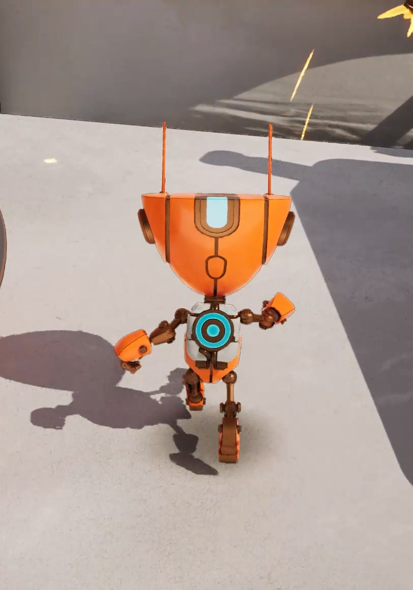

An edge record is built up over many frames. So when the camera or the objects move, each record has to follow the
surface it describes, the way a temporal upscaler's history buffer does. This post covers how a record is fetched from
the previous frame and moved into its new pixel. It also covers the tests that decide when a record no longer
describes the surface under its pixel: a depth test for creases, two tests for silhouettes, and a velocity test for
both. It is part of a [series]() and assumes the
[core idea]() and the
[silhouettes]() post.

The post has six parts:

1. Fetching the history: [moving a record](#moving-a-record-to-its-new-pixel) into its new pixel,
   [four bilinear taps](#nearest-pixel-or-bilinear-taps) instead of the nearest pixel, and
   [dropping the records](#dropping-records-out-of-sampling-range) that the pixel can no longer sample.
2. [Which velocity moves the records](#which-velocity-moves-the-records).
3. The tests of the surface under the pixel: [the crease depth test](#the-crease-depth-test) and
   [the silhouette tests](#the-silhouette-tests).
4. [What happens to a tap that fails them](#failed-taps-left-out-or-kept-through-a-missed-contour).
5. [The velocity test](#the-velocity-test), for the records a moving foot leaves on the floor.
6. [Every test at a glance](#the-tests-at-a-glance).

## Moving a Record to Its New Pixel

Each frame, before this frame's samples are added, every rendering pixel fetches the previous frame's records at its
**reprojected position**: the pixel's centre moved back by its motion vector.

- A pixel of a moving object reads its motion vector from the velocity buffer.
- Static geometry draws no velocity, so its motion is the camera's alone. It is computed from the pixel's depth and the
  previous and current projections, as the upscaler does it.

Both projections are taken without their jitter. So the reprojection is between pixel centres, not between the
jittered sample positions.

The reprojected position rarely lands on a pixel centre, and a record's statistics are expressed in its own pixel's
local coordinates. So the record has to be moved into the current pixel's coordinates. This is the half-rate shift of
the core idea post, for an arbitrary offset. If the current pixel's centre lies at $(o_u, o_v)$ from the history
pixel's centre, along and across the axis, the record's mean moves by

$$
\mu_u \leftarrow \mu_u - \tfrac12 o_u, \qquad \mu_v \leftarrow \mu_v - o_v ,
$$

and the variances and covariance stay as they are.

The half rate is the same as for the neighbour pooling. The record stores trapezoid midlines pinned to the pixel's own
boundary, so an edge that moves by $o_u$ moves the midline by $o_u/2$.

My first design stored raw moments, and a shift had to update five running averages, each with its cross terms. With
central moments, the whole move is the two subtractions above. The core idea post quotes them as the `ShiftRecord`
function.

## Nearest Pixel or Bilinear Taps

### Records Slip Past a Moving Edge

My first implementation fetched the record of the history pixel nearest to the reprojected position, and shifted it by
the remaining sub-pixel offset. That is geometrically right: the shifted record still describes the edge at its true
position.

But the record itself only moves by whole pixels, while the edge moves by a fraction of a pixel every frame. So every
frame, record and edge slip apart by the velocity's distance to the nearest integer:

- with a fraction below half a pixel per frame, the record stays in its pixel while the edge moves away, so records
  trail behind the edge;
- with a fraction above half, the record jumps a whole pixel each frame and runs ahead.

A pixel can only sample an edge that lies in it or in one of its two neighbours along the axis. Once a record has
slipped out of that range, it never gets another sample. It lingers while its count decays by 4% per frame:

![Three rows of five square pixels labelled A to E, one row per frame, with a nearly vertical black edge that moves 0.3 pixels to the right per frame, and a box labelled "B's record" under pixel B in every row. In frame 0 the edge is inside B, and a blue bracket under A, B and C marks the edges B can sample. In frame 3 the edge has moved into C; a short gray arrow inside B shows B's centre traced back 0.3 pixels, landing in B, so B fetches its own record, and a red dashed arrow from the record box to the edge shows that the record still decodes to it. In frame 6 the edge is inside D, outside the bracket, which is labelled in red as out of B's range; the red dashed arrow still reaches the edge, and the caption says the record never gets another sample and lingers while its count decays by 4% per frame](/assets/images/thin-outline/record-slip.svg)

I found this as a smear. With the camera moving, I looked at the records' sample counts as an image. They trailed or
led every moving crease by a band 20 to 30 pixels wide, which faded out over a second.

Here are the horizontal-axis crease records along one row of a vertical crease, in a frame captured under a steady
camera pan at 1280×720 and 100% screen percentage:

| x | n | Mean u | Edge the record decodes to |
|---:|---:|---:|---:|
| 430 | 5.43 | 0.835 | (fit invalid) |
| 431 | 9.27 | 0.318 | 430.65 |
| 432 | 7.95 | −0.215 | 430.59 |
| 433 | 5.96 | −0.771 | 430.5 |
| 436 | 2.93 | −2.715 | 430.1 |
| 444 | 0.15 | −8.289 | 430.2 |

Every record still points at the edge at $x \approx 430.5$, from up to 14 pixels away. And the pixels at the edge hold
only 5 to 9 samples, instead of the 25 that a static edge accumulates. The reason is that records keep sliding through
the three-pixel range in which they can be fed.

### Four Taps, Weighted by Sample Count

So the history is fetched the way a temporal upscaler resamples its own: from the four history pixels around the
reprojected position, the **taps**, with bilinear weights. Each tap's record is moved into the current pixel's
coordinates by its own offset, and its sample count is multiplied by its weight. Then the four records are merged with
the pooling of the core idea post:

![A three-by-three grid of last frame's pixels with their centres marked, and a red dashed square, this pixel's square traced back by its velocity, whose red centre lands between the centres of the four pixels in the upper right of the grid. A blue dashed rectangle connects those four centres, with the fractions f x equals 0.2 and f y equals 0.9 marked along its top and left sides, and the four pixels carry their bilinear weights 0.08, 0.02, 0.72 and 0.18. A table on the right lists, for the horizontal axis, each tap's weight, its offset, this pixel's centre relative to the tap's centre, and the shift of the record's mean, half the offset along the axis and the full offset across; a note says the merged count is 0.08 times the first tap's count plus 0.02, 0.72 and 0.18 times the others'](/assets/images/thin-outline/bilinear-taps.svg)

Let $f_x$ and $f_y$ be the fractional position of the reprojected centre between the four pixel centres. The weights
are then the usual $(1 - f_x)(1 - f_y)$, $f_x(1 - f_y)$, $(1 - f_x)f_y$ and $f_x f_y$.

Scaling a record's sample count by its weight scales the weight of every sample in it. So the merged record holds the
statistics of the union of the four records' samples, each tap's samples at that tap's weight. And the merged count is
the bilinear interpolation of the four counts:

```hlsl
// Merges one history record, moved into this pixel's coordinates, into the reprojected record with a weight: its
// samples keep their relative weights, scaled by Weight.
void AddHistoryRecord(inout FThinOutlineRecord Reprojected, FThinOutlineRecord Record, float2 Offset, float Weight)
{
	ShiftRecord(Record, Offset);
	Record.SampleCount *= Weight;
	Reprojected = MergeRecords(Reprojected, Record);
}
```

**Taps outside the view.** A tap outside the view gets no weight, and the weights of the others are not renormalized.
A record that came half from outside the view counts as half a record.

**Taps of another surface.** Each tap passes the history tests below on its own. So a pixel at a boundary between two
surfaces takes only the taps of its own surface.

**A static camera.** With a static camera, the reprojected position is the pixel's own centre, and one tap has all the
weight. Nothing changes against the nearest fetch.

### The Price of Four Taps

Records now follow the edge continuously, at two prices:

- **four history loads** per pixel instead of one;
- **lower sample counts**: every frame, the edge pixel's record is blended with its neighbour's, which holds fewer
  samples. So under motion, the counts stay below the static count.

Under the pan above, the smear was gone, and the near-horizontal creases moving along themselves drew about 20% more
outline than with the nearest fetch. Something else appeared instead: the moving vertical creases widened to a few
pixels. That is the bilinear blur, which the next section removes.

## Dropping Records Out of Sampling Range

The core idea post's table of recorded $u$ against the edge position says where a pixel's samples can lie. For an edge
at $u = E \in (-1, 2)$, the samples are midlines at $\tfrac12 + E/2$, so $u \in [0, 1.5]$.

After the reprojection, a crease record may have its midline outside that range over the pixel's whole height,
$v \in [0, 1]$. Such a record describes an edge the pixel can no longer sample. It is dropped instead of lingering:
this is the **range drop**.

The midline has to follow the record's own slope. A slanted edge that moves *across* the axis keeps its mean $u$ while
its samples leave the pixel. A first version that tested only the mean left the diagonal creases smeared.

```hlsl
const float Slope = Record.Variance.y > THIN_OUTLINE_MIN_FIT_VARIANCE ? Record.Covariance / Record.Variance.y : 0.0;
const float MidlineAtV0 = Record.Mean.x - Slope * Record.Mean.y;
const float MidlineAtV1 = MidlineAtV0 + Slope;
if (max(MidlineAtV0, MidlineAtV1) < 0.0 || min(MidlineAtV0, MidlineAtV1) > 1.5)
{
	Record = GetEmptyRecord();
}
```

### The Four Combinations

The table below shows the four combinations of fetch and range drop, in the same captured frame as above: a steady
camera pan, 1280×720, 100% screen percentage, drawn before the upscaler. In it:

- **stranded** records are those whose midline lies outside the sampling range;
- the alpha columns are the summed outline alpha drawn over the frame by each record type and axis.

| Fetch | Horizontal-axis crease records, stranded | Alpha: creases, horizontal axis | vertical axis | silhouettes, horizontal axis | vertical axis |
|---|---|---:|---:|---:|---:|
| nearest | 43,066, 80% | 620 | 4,584 | 37 | 2,378 |
| nearest, range drop | 8,549, 0% | 715 | 4,490 | 22 | 2,284 |
| bilinear | 33,298, 36% | 545 | 5,541 | 41 | 2,746 |
| bilinear, range drop | 20,410, 0% | 568 | 5,516 | 32 | 2,742 |

The pan moves the near-vertical creases, those of the horizontal axis, across their axis. That is where the slip
shows. With the nearest fetch, four records in five are stranded, and part of what they draw is stray dots. Beside one
sloped silhouette, there are dots of alpha 0.6 on every other column. They are most of the silhouette alpha that the
range drop removes.

Bilinear taps with the range drop are the combination I kept. It gives:

- thin lines on the vertical and diagonal creases alike;
- no band of stranded records;
- the most outline on the edges moving along themselves.

### Why Silhouette Records Have No Range Drop

The range drop applies to crease records only. A silhouette's records are kept by the foreground pixels, one and two
pixels from the contour on the foreground side. That is the far end of the sampling range. And the bilinear history
spreads a moving contour's records over one more pixel each frame.

Applied to silhouettes, the range drop removed the share that landed one pixel further inside the foreground,
although the contour was right next to it. Under the pan, the character's horizontal silhouette records lost a quarter
of their samples, and the drawn silhouette about a tenth. Instead, the [background test](#background-within-reach)
below bounds how far a silhouette record may drift.

## Which Velocity Moves the Records

Every pixel fetches its history with its own motion vector, because both kinds of record belong to the surface under
the pixel:

- a crease record describes a bend of that surface;
- a silhouette record is kept by a foreground pixel, so it describes the object in front.

### A Contour Pixel Sampling the Background

There is one exception. Take the pixel that contains a contour, with the foreground on its left.

- On the frames when its jittered sample lands on the foreground, it records silhouette samples, and its motion vector
  is the foreground's.
- On the frames when the sample lands on the background, its motion vector is the background's. But the records it
  holds are still the foreground's, from the other frames.

Fetching with the background's motion would move those records with the wrong surface. The pixel recognises such a
frame because its background check fires. On such a frame, it fetches with the motion vector of the neighbour that
check fired toward, the nearest one if several fired:

```hlsl
FThinOutlineForeground FindHistoryForeground(int2 PixelPos, FThinOutlineSample Center, FThinOutlineSample Neighbours[4], FThinOutlineEdges Edges)
{
	FThinOutlineForeground Foreground;
	Foreground.PixelPos = PixelPos;
	Foreground.DeviceZ = Center.DeviceZ;
	Foreground.bFound = false;

	// Reversed Z: nearer is larger.
	UNROLL
	for (uint Index = 0; Index < 4; ++Index)
	{
		if (Edges.BackgroundSilhouette[Index] > 0.0 && (!Foreground.bFound || Neighbours[Index].DeviceZ > Foreground.DeviceZ))
		{
			Foreground.PixelPos = ClampToViewRect(PixelPos + NeighbourOffsets[Index]);
			Foreground.DeviceZ = Neighbours[Index].DeviceZ;
			Foreground.bFound = true;
		}
	}

	Foreground.Depth = DeviceZToDepth(Foreground.DeviceZ);
	return Foreground;
}
```

The pixel's crease records, if it has any, ride on the same fetch. Each tap's records feed the reprojected record of
their own type, crease or silhouette. The axis then keeps one of the two by the takeover rules of the silhouettes post.

## The Crease Depth Test

As in TAA, history is thrown out when the surface under a pixel changes, and depth is the first thing to compare. Each
pixel stores the linear depth of its surface with its records. A crease tap is kept when its stored depth matches the
pixel's own depth within 5%. For the comparison, the pixel's depth is moved to the previous frame by the depth
component of its motion vector:

$$
\lvert\, D_{\text{tap}} - D_{\text{prev}} \,\rvert \le 0.05\, D_{\text{prev}} .
$$

### The Pixel Alone Is Enough

A crease lies on a depth-continuous surface. So a history pixel of the same surface differs from the pixel only by the
depth change across the jitter: the two samples being compared are up to a pixel apart on the surface.

An earlier version accepted a stored depth anywhere in the depth range of the pixel's same-surface neighbours, widened
by 2%. It rejected almost nothing, but it cost four edge measures per pixel. And it kept exactly the records it should
have rejected: a sample that had crossed a depth step still found a neighbour on the old surface. Under a pan, it kept
a diagonal crease band 10 to 18 pixels wide around a depth step, where the pixel test keeps 2 to 10.

### Why a 5% Threshold

The two samples are up to a pixel apart on the surface, and that is why the threshold is looser than a colour TAA's:

- on a surface seen at a grazing angle, a pixel's step in depth is large, and it doubles at 50% screen percentage;
- a crease is where the surface bends, so the depth around it does not follow a single plane.

The rejection rates in a static view at 1280×720, over every pixel whose history holds a crease record:

| Threshold | Rejected at 100% | at 50% |
|---:|---:|---:|
| 2% | 0.66% | 14.6% |
| 3% | 0.64% | 1.84% |
| **5%** | 0.57% | 1.76% |
| 10% | 0.53% | 1.68% |

At 50%, take the pixels whose depth changes by 2 to 10% toward a neighbour. They failed 38 to 47% of their frames at
2%, and about 0.5% at 5%.

What remains at any threshold are pixels on the character's outline. Their sample landed on the character in one frame
and on the wall behind it in the other, at depths of 400 and 2,070. Their crease record belongs to a surface the pixel
no longer shows, so rejecting it is right.

### What a Depth Test Cannot See

A depth test cannot see a crease record that slid along one continuous surface:

1. the records a foot leaves on the floor it stood on;
2. a junction's crease carried onto the curved wall next to it, as the camera uncovers the wall;
3. the copies that a face widening on screen gets from the crease beside it, since the history only shifts records.

The [velocity test](#the-velocity-test) at the end of this post catches the first. The presence of the
[flicker suppression]() post catches the other two: it
notices that no crease is found at the pixel any more.

## The Silhouette Tests

A silhouette record carries two more values than a crease record, both introduced in the silhouettes post:

- the **kept ratio**, which says on which side of the axis the record's background lies;
- the **foreground depth**, a running mean of the recording pixel's own depth, which is the depth of the object in
  front.

The stored foreground depth is last frame's. So before the tests, it is moved by the depth change of the pixel whose
velocity moved the history.

### The Foreground in Place

A silhouette tap is kept when its foreground depth matches, within 5%, the depth of the pixel itself or of its
neighbour toward the record's foreground side. The neighbour has to count because the pixel at the contour samples the
background on some frames. Its foreground is then next to it:

```hlsl
// Whether a reprojected silhouette record's foreground is still in place: the pixel itself, or its neighbour toward
// the record's foreground side, has the record's foreground depth. The pixel at the contour samples the background on
// some frames, and its foreground is then the neighbour. The neighbour depths are those of the first (left or top) and
// second (right or bottom) neighbour of the axis.
bool IsForegroundInPlace(FThinOutlineRecord Record, float CenterDepth, float FirstNeighbourDepth, float SecondNeighbourDepth)
{
	// Samples recorded through the first check have their background on the first side.
	const float NeighbourDepth = Record.KeptRatio >= 0.5 ? SecondNeighbourDepth : FirstNeighbourDepth;
	const float Tolerance = SilhouetteHistoryDepthThreshold * Record.ForegroundDepth;
	return any(abs(float2(CenterDepth, NeighbourDepth) - Record.ForegroundDepth) <= Tolerance);
}
```

#### Why One Neighbour Is Enough

In my first layout, the records were kept on the background side, and the test had to reach two pixels toward the
foreground. The pixel one outside the contour sees its foreground two pixels away, on the frames when the contour pixel
samples the background. In a static view, with records on the background side and a 2% tolerance:

| Pixels compared with the foreground depth | Rejected at 100% | at 50% |
|---|---:|---:|
| the pixel and one step | 35% | 40% |
| the pixel, one and two steps | 2.7% | 3.5% |

The remaining few percent did not depend on the tolerance. They were records whose foreground really had moved, such as
the animated character's head against the sky. With the records on the foreground, one step is enough.

#### Why a 5% Tolerance

The 5% tolerance comes from the same place as the crease threshold. A foreground seen at a grazing angle changes depth
by a few percent per row, and the jitter moves both samples by up to a pixel. Along the grazing top of a ramp in my
test level, under a pan, 2% lost a part of the silhouette that 5% kept.

**Half precision.** The foreground depth is stored in half precision, and a running mean stored that way stalls when an
update is smaller than half a float step. A simulation of 400 frames, with samples spread by up to 3%, kept the stored
mean within 0.4% of the exact one, well inside the tolerance.

### Background Within Reach

A silhouette is view-dependent: as the view direction turns relative to the surface, the contour slides over it. A
record that moved with its foreground surface can therefore end up inside the foreground, where its contour no longer
is. The foreground test can't tell, because the foreground is still there.

So there has to be a background within two pixels toward the record's background side. A background is within reach in
a direction when any of these holds:

- the pixel itself samples the background of a silhouette this frame, that is, its background check toward the
  opposite side fires;
- the neighbour on that side is behind a silhouette, so the pixel's own silhouette check toward it fires;
- the pixel beyond that neighbour is the background: it is farther than the neighbour, and off the line through the
  pixel and the neighbour. This is the silhouette measure seen from the neighbour, without its symmetric term, which
  would need a third pixel.

I compared that measure with a plain depth step of 5% in its place. The two gave nearly the same picture, and the
measure is the one kept.

**Why two pixels.** The foreground pixel one inside the contour has no background neighbour on the frames when the
contour pixel samples the foreground. The background is then two pixels away.

The four directions are tested once per frame, before the fetch. Each reprojected silhouette record then looks up its
own background side:

```hlsl
// Whether a reprojected silhouette record of the axis whose first neighbour is FirstIndex (NeighbourOffsets order) has
// background within reach toward its background side (see GetBackgroundInReachMask).
bool HasBackgroundInReach(FThinOutlineRecord Record, uint FirstIndex, uint BackgroundInReachMask)
{
	// Samples recorded through the first check have their background on the first side.
	const uint BackgroundIndex = Record.KeptRatio >= 0.5 ? FirstIndex : FirstIndex + 1;
	return (BackgroundInReachMask & (1u << BackgroundIndex)) != 0;
}
```

This test runs on the merged record, after the taps, since the background side is a property of the record, not of a
tap.

#### No Threshold on the Turn Rate

The test has no threshold on how fast the view may turn. A record is kept as long as its contour is still beside it,
and dropped as soon as it is not, whatever the camera or the object did.

I measured it in a camera orbit around the character and with the character spinning in place, at 1280×720 and 100%
screen percentage. The table counts the character's drawn silhouette pixels, and how many of them are **detached**,
with no depth step within two pixels along their axis:

| Scenario | Silhouette pixels on the character | Detached |
|---|---:|---:|
| camera orbit, 0.5° per frame | 3,264 | 0 |
| camera orbit, 1.5° per frame | 1,925 | 0 |
| character spin, 0.5° per frame | 2,742 | 0 |
| character spin, 1.5° per frame | 3,205 | 0 |

### Why Not the View Direction

My first design handled the view-dependence of silhouettes differently. It rejected a silhouette record when the view
direction through the pixel had turned by more than a threshold angle since the record was made. The angle was
measured:

- in the plane that matters, the one through the camera and the edge;
- relative to the surface, so that an object turning in front of a still camera counted too.

It worked as designed and was still the wrong tool, because a hard threshold is all or nothing. In the same orbit, with
that test in place of the background test:

| Orbit | Test off | 2° per frame | 1° | 0.5° |
|---|---|---|---|---|
| 0.5° per frame | 4,153 px, 10.2% detached | same as off | same as off | 1,698 px, 1.6% |
| 1.5° per frame | 2,513 px, 23.7% detached | same as off | 767 px, 5.1% | |

- **While the camera turns slower than the threshold**, nothing is rejected and the silhouette lags: a tenth of its
  pixels detached at 0.5° per frame, a quarter at 1.5°.
- **Faster**, the vertical parts of the silhouette reset every frame and mostly vanish.

So the threshold only picks the turn rate at which lag turns into absence. And sharp silhouettes, such as a box's
edges, which never slide, were rejected along with the smooth ones.

The background test above replaced it. It leaves no detached pixel in any scenario. At the fast turns, it keeps two to
two and a half times the silhouette that the view-direction test left.

## Failed Taps: Left Out, or Kept Through a Missed Contour

What happens to a tap that fails a history test depends on which test it failed. The two kinds of failure mean
different things.

### A Failed Depth Test Is Final

A tap that fails the crease depth test, or the foreground test of a silhouette record, is left out. Its weight is set
to 0, and the remaining taps keep their bilinear weights, as for taps that fall outside the view. If every tap fails,
the record is empty and the pixel starts over.

That is the right answer, because the jitter hardly ever causes such a failure:

- **Silhouettes.** The pixel and its neighbours sample the same jitter offset. So when a contour pixel's sample lands
  on the background, its foreground-side neighbour's still lands on the foreground. The foreground test accepts
  either, so it passes.
- **Creases.** A crease record lives on one depth-continuous surface. The jitter moves its depth by less than the
  test's 5%, except at a grazing angle, which the threshold was chosen to cover.

When both the pixel and its neighbour have lost the record's depth, the surface the record describes is gone from under
it. A record kept there can only describe something that is no longer there.

I did not always treat it so. For a while, a record that failed its depth test was kept on a pixel that was not moving,
and faded out over about a dozen frames, on the theory that the jitter might be to blame. It was not, and the kept
records showed as trails. A tree's contour sliding across a sky mesh a few kilometres away left its records behind on
the sky's pixels, which hardly move on screen when the camera moves sideways. With the draw ramp off, they drew at full
strength for ten frames behind the contour.

Leaving failed taps out removed the trails. In the test view I use for flicker, described in the flicker suppression
post, it raised the strongly flickering display pixels only from 38 to 41. Dropping records through the background
test as well, below, raises them to 60.

### A Missed Contour Is Not

The background test is different. It fails when no silhouette check fired within two pixels of the record's background
side this frame, and the jitter does cause that. A face seen at a grazing angle next to a depth step sits close to the
silhouette threshold. On one phase of the cycle, the check misses the step, while the foreground's depth still matches.

A record dropped then would restart with one sample, and it needs three for a fit. The outline would be missing for a
few frames every cycle.

![One square rendering pixel, mostly purple foreground with a gray strip of the surface behind it at its right edge beyond a thick black contour, and eleven numbered jitter positions spread over it, two of which, frames 7 and 11, are drawn red: on those frames the silhouette check misses the step. To the right, a timeline of eleven frames with rows: contour seen, a check mark on every frame except 7 and 11; the background test, passing on every frame except 7 and 11; then two alternatives. "Dropped at once" shows the sample count staying at 25 for frames 1 to 6, falling to 1 on frame 7, climbing to 2, 3 and 4 on frames 8 to 10, and falling to 1 again on frame 11, with the outline drawn on frames 1 to 6, 9 and 10 only. "Kept and faded" shows the presence at 1 for frames 1 to 6, then 0.75, 0.81, 0.86, 0.89 and 0.67, with the outline drawn on every frame. A caption explains that on frames 7 and 11 the silhouette check misses the step, a face at a grazing angle sitting close to the threshold, so no contour is found within reach and the background test fails while the foreground's depth still matches; that dropping restarts the record from one sample, so with three needed for a fit the outline is missing on frames 7 and 8 and from 11; and that keeping the record and sinking its presence by a quarter per such frame keeps the outline drawn, a little dimmer for a frame or two, while only a dozen such frames in a row drop it](/assets/images/thin-outline/jitter-depth-failure.svg)

So a silhouette record that fails the background test is kept and marked as failed. What happens next is up to its
presence:

1. **A failed frame counts as a frame on which the edge was not found** at the pixel. That is what the record's
   presence $p$ tracks: a running average of "found this frame", which is 1 for a record found on every recent frame.
   Each frame, it is updated as $p \leftarrow p + \tfrac14 (f - p)$, with $f = 1$ on a found frame and $f = 0$ on a
   failed one. So it moves a quarter of the way toward 1 or toward 0 each frame. The outline is drawn a little dimmer
   while $p$ is low.
2. **The record drops or recovers depending on what follows.** While the failed frames keep coming, the presence keeps
   sinking. Once it falls below a drop level, after about a dozen failed frames in a row, the record is emptied. If a
   found frame breaks the run, the presence starts rising again and the record recovers. One bad phase of the jitter
   cycle only dents it, as the timeline above shows.

The [flicker suppression]() post defines the presence and its
draw ramp.

### The Moving Gate

Keeping a record through a missed contour has a limit. On a pixel moving at 0.05 pixels per frame or faster:

- a record whose contour is missed is dropped at once;
- a silhouette sample takes a crease record over at once, where on a still pixel it has to wait for the crease's
  presence to sink.

The jitter's misses are a problem of still pixels, whose check meets the same step every cycle. On a moving pixel, a
missed contour usually means that the contour has slid away over the surface, and a record kept there trails behind.

When I measured it without the gate, kept silhouette records trailed moving contours: 6% of the drawn silhouette pixels
were detached under a camera pan, 11% under a camera orbit at 0.5° per frame and 19% at 1.5°. With the gate, and
failed depth taps left out at any speed, the pan, the orbit and a spinning character leave a handful of detached pixels
per frame.

## The Velocity Test

### Records a Foot Leaves on the Floor

In Epic's Stack O Bot sample, the walking character left crease ghosts at its feet: a short trail of outline on the
floor behind each foot. The tests above all let it through:

1. The floor pixel the foot has just uncovered fetches its history with its own velocity, which is the camera's
   motion. So its fetch lands on the pixel that showed the foot last frame, and it takes the foot's crease records.
2. The depth test passes: the foot stood on the floor, so the depths match within 5%.
3. No crease is found at the floor pixel, so the record's presence sinks. But it sinks over about twelve frames, and
   the outline is visible for about four of them. That is the trail.

Silhouette records have their two guards against the same slide. A crease record has only its depth, and a crease
joins two surfaces without a depth step, by definition. (A hard limit on frames without a crease removed these
footprints, but it blinked every crease that is found on some frames only. The flicker suppression post tells that
story.)

What differs between the foot and the floor is their **motion**: the foot's pixel moved on its own last frame, and the
floor's did not. So each pixel stores, with its records, the velocity they moved with. A tap whose stored velocity
disagrees with the fetching pixel's is left out.

### The Object Velocity

The velocity stored is not the full velocity, though. Every pixel's velocity holds the camera's motion. When the camera
speeds up, slows down or turns, every stored velocity differs from this frame's by that change, static geometry
included. A mouse flick, for example, goes from 0 to 20 pixels per frame within a frame. With the full velocity, every
tap of such a frame would fail.

What is stored and compared is the **object velocity**: the pixel's velocity minus the velocity that a static point at
the same screen position and depth would have this frame, in viewport pixels per frame.

```hlsl
float3 GetPixelVelocity(int2 PixelPos, float DeviceZ, out float2 ObjectVelocity)
{
	const float4 EncodedVelocity = SceneTexturesStruct.GBufferVelocityTexture.Load(int3(PixelPos, 0));
	const float3 StaticVelocity = ComputeStaticVelocity(ViewportPosToScreenPos(PixelPos - int2(View.ViewRectMin.xy)), DeviceZ);
	ObjectVelocity = 0.0;
	if (EncodedVelocity.x <= 0.0)
	{
		return StaticVelocity;
	}
	const float3 Velocity = DecodeVelocityFromTexture(EncodedVelocity);
	ObjectVelocity = ScreenVelocityToViewportPixels(Velocity.xy - StaticVelocity.xy);
	return Velocity;
}
```

- A pixel of static geometry gets exactly 0, every frame, whatever the camera does.
- A pixel of a moving object gets the screen projection of the object's own motion. That does not depend on the
  camera's motion either, since both terms are taken at the same depth.

The footprint is then a tap with a non-zero object velocity, fetched by a pixel whose object velocity is 0. A camera
acceleration changes nothing.

### The Tolerance

What is left is the object's **own** acceleration: the velocity stored last frame lags this frame's by one frame of it.
A swinging foot at 10 pixels per frame changes its speed by one or two pixels per frame per frame. So the tolerance has
a part relative to the fetching pixel's speed. A tap is kept when

$$
\lvert\, \mathbf v_{\text{tap}} - \mathbf v_{\text{fetch}} \,\rvert
\le 0.5 + 0.5\, \lvert \mathbf v_{\text{fetch}} \rvert
$$

pixels per frame. A static pixel, the floor under the foot, allows the base tolerance only.

```hlsl
bool IsHistoryTapOnFetchSurface(float2 TapObjectVelocity, float2 FetchObjectVelocity)
{
	const float2 Difference = TapObjectVelocity - FetchObjectVelocity;
	const float Tolerance = HistoryVelocityTolerance + HistoryVelocityRelativeTolerance * length(FetchObjectVelocity);
	return dot(Difference, Difference) <= Tolerance * Tolerance;
}
```

### Which Velocity Is Stored

A pixel stores the **fetch's** velocity: the one its records moved with this frame. That is the pixel's own, except on
the frames when it samples the background next to a contour and fetches with the foreground neighbour's.

That detail matters. Take the floor pixel that the foot's contour sweeps over:

1. On that frame, it fetches with the foot's velocity, receives the foot's records, and stores the foot's velocity
   with them.
2. Next frame, as a plain floor pixel, it fetches with its own velocity, and the mismatch catches the records.

Had it stored its own velocity, the foot's records would have become the floor's.

![Two rows of six square pixels, last frame above and this frame below, with a purple foot covering the left pixels of each row and its edge drawn as a thick black line, in the third pixel of the upper row and the fourth of the lower one; a label says the foot moves one pixel per frame to the right and the pixels to the right are static floor. Under the upper row's third pixel a box reads "record, stored v = 1". In the lower row the third pixel is labelled P, floor now, and the fourth Q, the foot's edge. A red dashed arrow runs straight up from P to the record box, crossed out, with the note that P is floor with object velocity 0, fetches straight up, and the tap stored with 1 is left out. A green dashed arrow runs from Q one pixel to the left up to the same record box, with a check mark and the note that Q has object velocity 1, fetches one pixel to the left, and the tap stored with 1 is kept. A caption repeats the rule: each pixel stores the object velocity its records moved with, and a tap is left out when its stored velocity differs from the fetching pixel's by more than 0.5 pixels per frame plus half that pixel's own speed](/assets/images/thin-outline/velocity-test.svg)

### Dropped, Not Faded

A tap that fails the velocity test is left out, with weight 0, like one that fails a depth test. The reason is the
same: the jitter cannot cause the failure, since static geometry is exactly 0 on both sides, and a kept record would be
precisely the ghost. On a still camera, the floor pixel is not moving, so the moving gate would not drop a kept record
either, and a faded footprint would last as long as it did before.

The remaining taps keep their bilinear weights, as for taps outside the view. So a pixel at the border of a footprint
gets a lighter record once.

The test applies to both record types, because it is a test of the tap's surface, not of its edge. A silhouette record
of the foot on a floor pixel usually fails the background test anyway. But a part of the foot within two pixels keeps
the background in reach.

### Why Not a Forward Projection

I tried a second form first: move each tap forward to this frame by its own stored velocity, and keep it only if it
still overlaps the pixel. The camera's share of a tap's motion has to be taken to be the fetch's, for the same reason as
above. Once it is, the forward projection is the same comparison, with the tap's bilinear offset folded in:

- a tap already 0.9 pixels off on one side fails from 0.1 pixels of extra motion;
- a tap 0.1 pixels off fails only from 0.9.

So the same foot at the same speed was caught or missed by its sub-pixel alignment, which alternates pixel by pixel
along a trail. In a test, the forward projection cleared only the faster of the two feet.

The two forms cost the same. And the velocity match has a threshold that means one thing: how differently from the
fetching pixel a tap's surface may have moved, in pixels per frame.

### What It Catches

In my test project, the character spun in place fast enough for its feet to move 1 to 3.5 pixels per frame, at
1280×720 and 100% screen percentage. The crease record pixels around the feet went from 638 without the test to 541
with it. The removed ones lie along the soles' contact line with the floor, on both feet, reproducible to one pixel
between runs.

- At a slower spin, with the feet under one pixel per frame, no trail forms and nothing changes.
- Under a camera pan, the records on everything outside the character are the same with and without the test, within
  0.1%.

In Stack O Bot, the difference is plain to see. The character walks away from the camera, so every step uncovers floor
right behind its feet. Without the velocity test, the floor pixels uncovered there take over the feet's crease
records, and a trail of thin dashed lines runs down the floor from each foot:


With the velocity test, those taps are left out: their stored velocity is the feet's, and the floor pixels fetching
them have none. The outlines stay on the feet:



### What It Does Not Cover

- **A foot lifting from rest.** On the first frame a foot lifts from rest, its stored velocity is still the floor's.
  So the floor it uncovers on that one frame is not caught, though it is the frame after. And a lift-off uncovers less
  than a pixel.
- **An abrupt stop.** An object that stops abruptly, from above the tolerance to zero in one frame, loses its records
  once and rebuilds them over a few frames.
- **Run-to-run variation.** With the test on, the records of a fast-spinning character vary from run to run by about
  5% of their pixels, because taps near the tolerance flip between pass and fail. Whether its own creases are visibly
  less steady is something to judge in play. If they are, the relative part of the tolerance is what to raise.

## The Tests at a Glance

| Test | Record type | A tap is kept when | A failing tap |
|---|---|---|---|
| sampling range | crease, on the merged record | its midline stays within $[0, 1.5]$ over the pixel's height | the record is dropped |
| depth | crease | its stored depth matches the pixel's own, moved to the previous frame, within 5% | left out; if every tap fails, the record is empty |
| foreground in place | silhouette | the record's foreground depth matches the pixel's or its foreground-side neighbour's, within 5% | left out, as for the depth test |
| background within reach | silhouette, on the merged record | a background lies within two pixels toward the record's background side | the record is kept as failed and its presence sinks; on a pixel moving at 0.05 pixels per frame or faster it is dropped at once |
| velocity | both | its stored object velocity matches the fetch's within 0.5 pixels per frame plus half the fetch's speed | left out |

Then the counts decay, this frame's samples are added, and the records are stored for the next frame.

## What the Other Posts Cover

- The [flicker suppression]() post defines the presence that
  the failed tests feed. It also covers the ghosts that the depth test cannot see and the velocity test does not
  catch: records slid along a surface, and copies on a face widening on screen.
- The [silhouettes]() post has the kept ratio and the foreground
  depth that the silhouette tests read.
- The [tile classification]() post has how the history fetch
  is skipped for the pixels that have no records nearby.
