This is an algorithm for drawing toon-style outlines from G-buffer data alone. The outlines are thinner than one
rendering pixel and stay crisp under a temporal upscaler such as TSR. This post replaces my
[post from September](), which described the
first design. The algorithm changed in several places while I implemented it, and this series describes what it does
now.

![Five crops of the same toon character's face, blue hair and a bow tie against a sky, a barn and a hedge, rendered at 50% screen percentage, each labelled: no outline; a plain outline one rendering pixel wide, which draws thick dark lines around the hair, the face and the clothes; the thin outline drawn before the upscaler under TSR and under DLSS, whose lines are thin but softened; and the thin outline drawn after the upscaler, whose lines are crisp and about one display pixel wide. Under each face, the 167 by 152 display pixels inside a red rectangle on the hair's edge are enlarged three times without smoothing: the plain outline is a stepped line two pixels wide, the lines drawn before the upscaler are soft and spread, and the line drawn after it is one pixel wide and follows the edge's slant.](/assets/images/thin-outline/intro-comparison-zoomed.png)

*The scene at 50% screen percentage without an outline, with a plain
G-buffer outline one rendering pixel wide and blurred, and with the thin outline drawn
before the upscaler (TSR, DLSS) and after it. Under each, the pixels inside
the red rectangle enlarged three times. The full pictures are in the
[results](#results).*

## The Problem

A common way to draw outlines is to look for contours in the G-buffer. You compare the depth and normal of
neighbouring pixels, and flag an edge where they differ by more than a threshold. This works well until a temporal
upscaler (TAAU, TSR, DLSS, FSR, XeSS) enters the pipeline.

The upscaler renders the scene at a reduced internal resolution, set by the **screen percentage**. Over time, it
reconstructs a full display-resolution image from it.

A G-buffer contour detector only has samples at rendering resolution. So the thinnest outline it can draw is one
rendering pixel wide. After upscaling, that becomes about `1 / screen_percentage` display pixels: two at 50% screen
percentage, four at 25%.

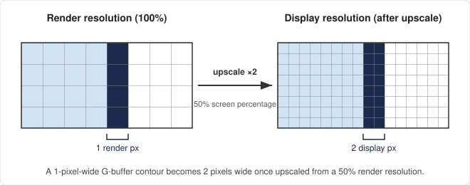

Geometry-based outlines, such as an inverted hull, don't have this problem. Their outline is a mesh, rasterized at a
slightly different sub-pixel jitter every frame. The upscaler accumulates those jittered samples into an anti-aliased,
sub-pixel-accurate edge, like any other geometry.

A G-buffer detector's output is a yes or no per rendering pixel, on a fixed grid. The upscaler has nothing finer to
accumulate. So the outline gets thicker in display pixels exactly when the screen percentage is below 100%.

## The Idea in Short

The algorithm turns the detector's yes-or-no answers into a line segment:

1. Each frame, the G-buffer is sampled at that frame's jittered sub-pixel position. So each frame's detection says
   whether an edge passes between two jittered sample points.
2. Over the frames of the upscaler's jitter sequence, those answers trace out the region where the edge is
   detectable.
3. From that region, each rendering pixel reconstructs the equation of the edge's line with a statistical method,
   [ordinary least squares](https://en.wikipedia.org/wiki/Ordinary_least_squares).

The line is then drawn with any thickness you like, even thinner than a rendering pixel or a display pixel. The
outline no longer depends on the screen percentage.

### Creases and Silhouettes

Two kinds of edges are drawn:

- **creases**, where the normal changes abruptly on a continuous surface;
- **silhouettes**, where the depth jumps between a foreground and a background.

Both are reconstructed the same way. Each pixel keeps one record per **inducer axis**:

- the horizontal axis: the left and right checks;
- the vertical axis: the top and bottom checks.

Each record is either a crease record or a silhouette record.

### The Three Steps of a Frame

**Recording**, at rendering resolution, before the upscaler. Every rendering pixel:

- fetches last frame's records at the position the motion vectors point to;
- tests whether they still belong to the same surface;
- decays them;
- runs this frame's crease and silhouette checks on the jittered G-buffer;
- adds the samples that fired to the records.

**Reconstruction**, once per rendering pixel. Each pixel:

- pools its record with its neighbours';
- fits the edge;
- picks between the horizontal and vertical candidates;
- filters the line against its neighbours' lines;
- suppresses edges that are crowded or too short;
- scales the edge's strength by how consistently the edge has been found.

The result is one line per rendering pixel.

**Drawing.** Each display pixel is painted by the exact area of the outline band around that line inside it. This
happens in one of two places:

- before the upscaler (the default), at rendering resolution. The upscaler then has to be told the foreground's depth
  and velocity under silhouette pixels, so that it moves the outline with the object in front;
- after the upscaler, at display resolution.

## Results

Every picture below was taken at 50% screen percentage, so a rendering pixel is two display pixels wide. Each scene
is shown under five settings:

- no outline;
- a plain outline, drawn at rendering resolution and blurred in proportion to the screen percentage (50%) to make it
  look thin: the kind of outline a post-process material gives;
- the thin outline drawn before the upscaler, under TSR;
- the same thin outline drawn before DLSS;
- the thin outline drawn after the upscaler, at display resolution.

The thin outline is set to about one display pixel in every shot. The small crops are the same rectangle of display
pixels from each picture, enlarged without smoothing so that the pixels can be compared.

### A Toon-Style Scene

A sample character from VRoid Studio in front of a fantasy-style town. 
This is the kind of scene the outline is meant for.

<table>
<tr>
<td>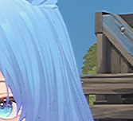<br><em>No outline</em></td>
<td>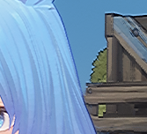<br><em>Plain outline</em></td>
</tr>
<tr>
<td>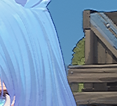<br><em>Thin outline, before the upscaler (TSR)</em></td>
<td>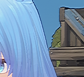<br><em>Thin outline, before the upscaler (DLSS)</em></td>
</tr>
<tr>
<td>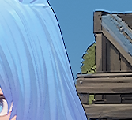<br><em>Thin outline, after the upscaler</em></td>
<td></td>
</tr>
</table>

The full crops, at display resolution:

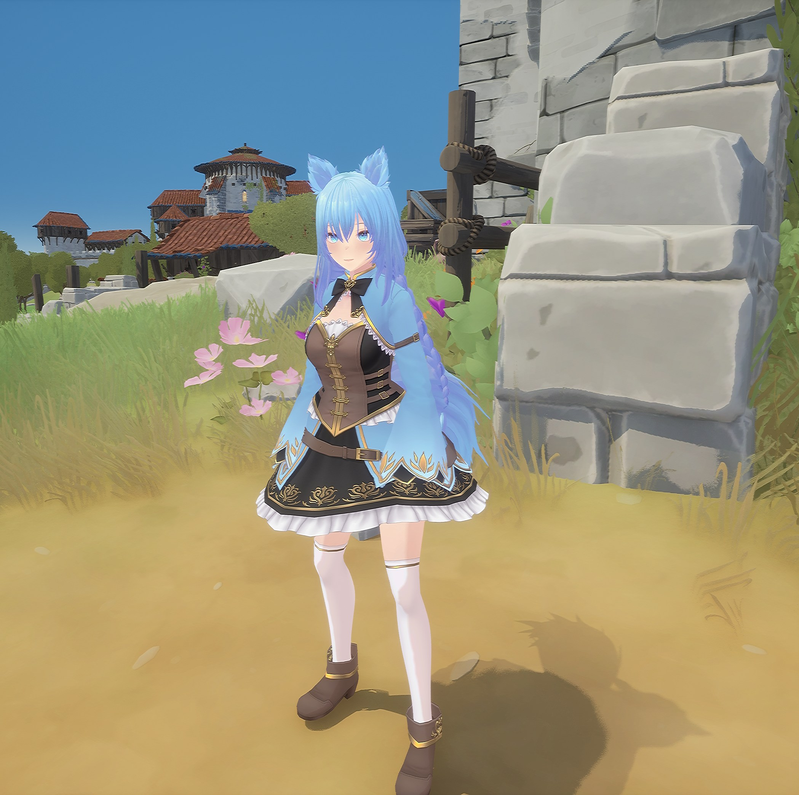

*No outline.*

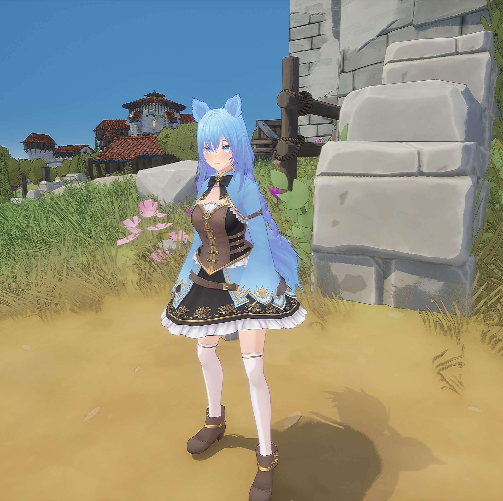

*A plain outline, one rendering pixel wide and blurred in proportion to the screen
percentage. At 50% screen percentage, the outline's strength is halved. It is still two display pixels wide.*

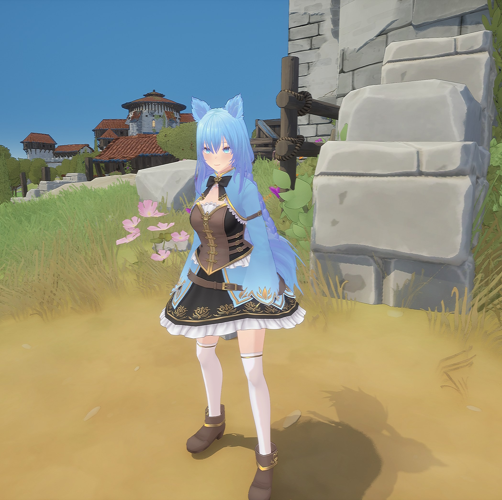

*The thin outline drawn before the upscaler, TSR.*

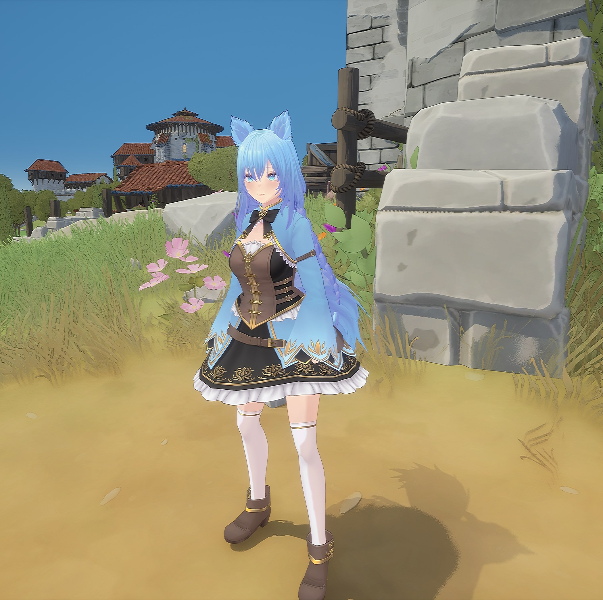

*The thin outline drawn before the upscaler, DLSS.*

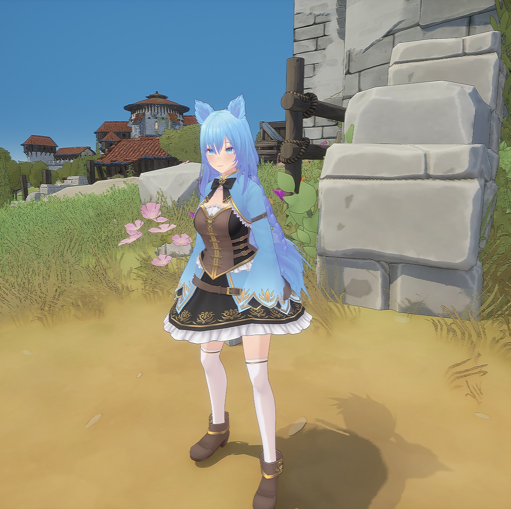

*The thin outline drawn after the upscaler.*

The town is the free Fab pack
[Stylized Provencal](https://fab.com/s/498d7348d149); the character is a sample model from [VRoid Studio](https://vroid.com/en/studio).

### The Third-Person Template

The engine's third-person template, which is where I checked the outline's basic quality while building the algorithm.

<table>
<tr>
<td><br><em>Plain outline</em></td>
<td>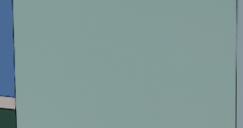<br><em>Thin outline, before the upscaler (TSR)</em></td>
</tr>
<tr>
<td>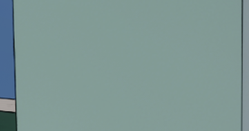<br><em>Thin outline, before the upscaler (DLSS)</em></td>
<td>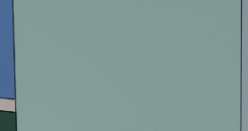<br><em>Thin outline, after the upscaler</em></td>
</tr>
</table>

The full crops:

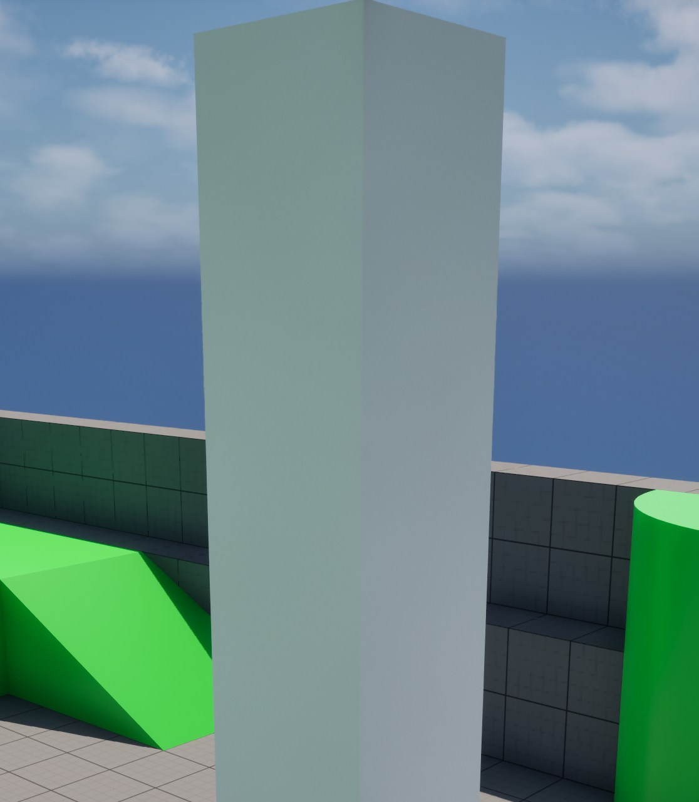

*No outline.*

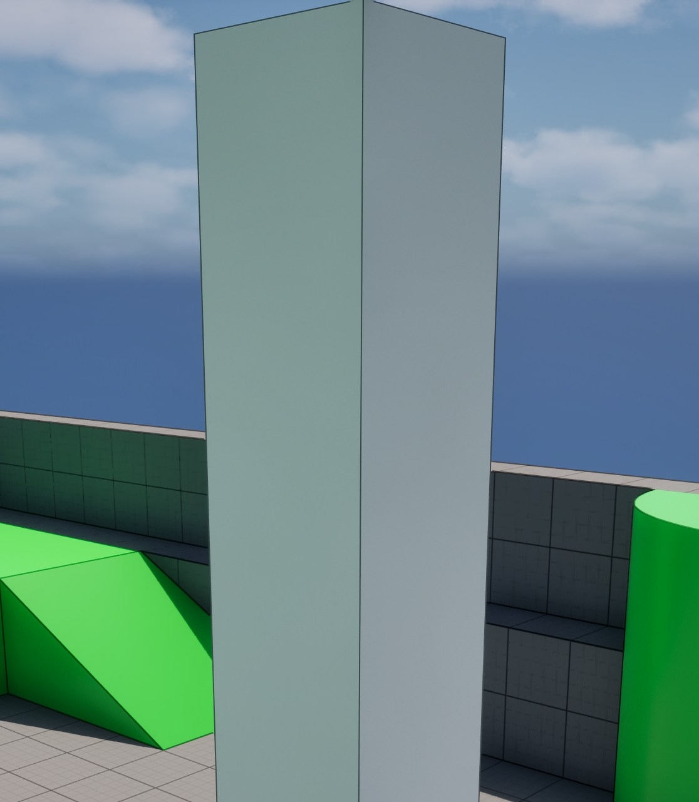

*A plain outline, one rendering pixel wide and blurred in proportion to the screen
percentage.*

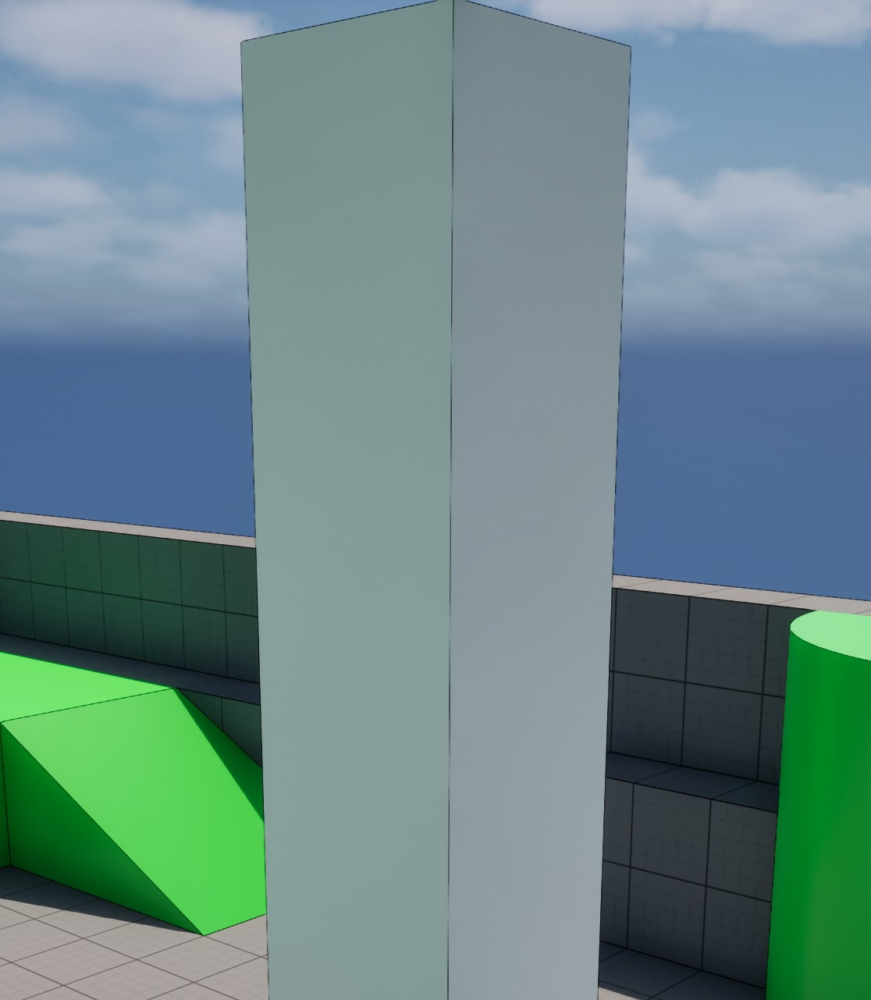

*The thin outline drawn before the upscaler, TSR.*

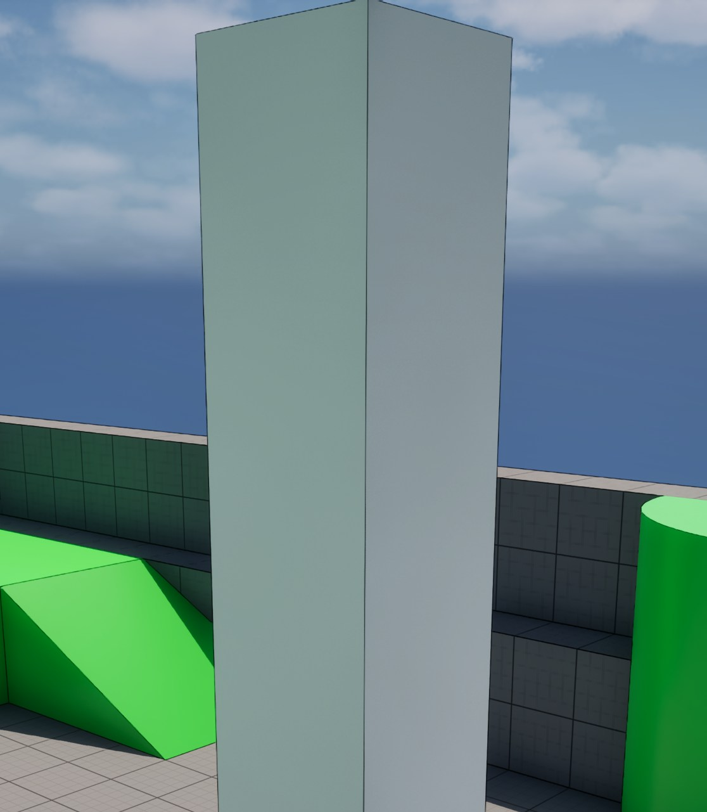

*The thin outline drawn before the upscaler, DLSS.*

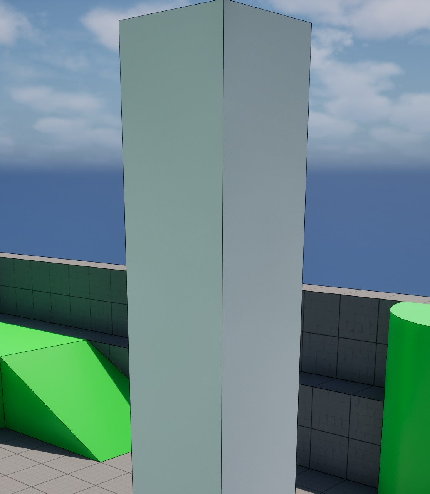

*The thin outline drawn after the upscaler.*

Screenshots of the same five conditions in Epic's City Sample are at the
[bottom of this post](#city-sample-screenshots).

## The Parts

- [The core idea](): how a
  temporal least-squares record per pixel and axis reconstructs the edge
  and how records are stored.
- [Silhouettes](): the complications that silhouettes add.
- [History reprojection]():
  how a record follows its surface from frame to frame.
- [Spatial filters]():
  applying a spatial filter to make the outline more consistent from pixel to pixel.
- [Flicker suppression]():
  how to suppress outline flickering artifacts.
- [Tile classification]():
  running the drawing passes only on the tiles within reach of an outline record.
- [Drawing after the upscaler]():
  drawing the outline after the upscaler or before it.

## The Implementation

I implemented the algorithm as an Unreal Engine plugin, ThinOutline, against a source build of 5.8:
<https://github.com/donguklim/thin-outline-plugin>. The posts quote short pieces of its HLSL where a formula is
clearer as code. The numbers they give were measured with it.

## Limitations

### Sub-Pixel Details

The algorithm samples as finely as the G-buffer, and no finer. Every check compares two samples one rendering pixel
apart. The reconstruction assumes a band one full pixel wide around each edge, in which that comparison fires.

A thin wire, a small hole or a narrow gap thinner than a rendering pixel breaks that assumption. The checks fire only
on the few frames where the two samples happen to straddle the detail, so its edges are reconstructed partially or
not at all. Geometry one pixel thin is deliberately dropped at sampling time.

### Statistical Noise

The lines are estimates from samples accumulated over time, so they carry variance:

- a record that has just appeared or been reset wobbles until enough frames have accumulated;
- a converged record still keeps a residual wobble, because the decay caps how many samples it effectively holds;
- every yes-or-no decision made from an estimate, such as which axis to draw, turns a little noise near the threshold
  into a visible flip.

Much of the series, from the pooling to the presence and the spatial filter, is about keeping that noise from turning
into dashed or blinking outlines.

### Fog and Translucency

Drawing after the upscaler paints the outline over everything composited before it, fog and translucency included.
Drawing before the upscaler puts the outline under some of the translucency, but the outline is not fogged either.

### A Small Bias at 100% Screen Percentage

TSR's jitter sequence has 11 positions there, and the 11-point Halton set is not mirror-symmetric. So lines of one
slope sign are drawn about 0.1 pixels off; mirroring the jitter in a simulation moves the error to the other sign.
It is a property of fitting lines to a short, lopsided point set, not a logic bug. It is gone from 50% screen
percentage on, where the sequence has 37 positions.

## How I Came Up with the Algorithm

I was working on outlines, and I started with a simple G-buffer algorithm. It checked the four axial neighbours of
each pixel and decided whether to paint the pixel with the outline. To make the result look thin, I blurred it.

Then I had an idea: record the extreme position along the inducer's axis at which the G-buffer check detected the
edge.

- For the left inducer, I recorded the minimum x at which the outline was detected.
- For the right inducer, I recorded the maximum x.
- For the vertical inducers, I did the same with y.

The outline was then painted only when the jittered sample position fell within that recorded range. I asked Claude
Fable to implement it.

Of course, that only worked for axis-aligned edges. A single extreme along
one axis can't describe a slanted edge, so diagonal edges came out jagged.

So I went back to the blurring method, and then found that dense outlines flickered. My first fix was to accumulate
the outline's strength over time, as an alpha value. That made the outline worse and the jagging stronger. Every
jittered sample within a rendering pixel now produced the same result, so the upscaler had no sub-pixel detail left
to reconstruct.

Next, inspired by the SVGF paper, I asked Fable to add a weighted temporal filter. A temporal estimator tracked the
variance of each pixel's outline alpha, and the filter was applied only to pixels with high variance. (This method is
no longer used.)

Then I came up with another idea. I had been recording only the minimum or maximum along one axis. What if I recorded
both the minimum and the maximum along the inducer's axis, together with the other coordinate at the moment each
occurred?

For the left inducer, say the detected position with the smallest x so far was (0.1, 0.2), and the one with the
largest x was (0.8, 0.7). I'd record both points. If a later sample detected the edge at (0.9, 0.77), it would
replace (0.8, 0.7). Those extreme points trace out the parallelogram-shaped region where the edge can be detected,
and from that shape comes the edge's line segment itself.

To let stale records be replaced, the recorded extremes would decay over time: the minimum creeping up and the
maximum creeping down. An old extreme would eventually lose to a fresh sample.

I asked Fable about this idea, and its answer came down to four points:

- A min/max record like this is statistically unstable.
- A single outlier can corrupt the record, and it may not be superseded for
  a long time.
- Why not use OLS regression instead?
- As in the SVGF paper, temporal accumulation can build unbiased estimators.

I was flabbergasted. I simply hadn't thought of OLS regression, even though
it's something you learn in a first- or second-year university statistics
course.

Fable didn't hand me a brilliant idea out of nowhere. It filled a hole. But
that hole was in a critical, load-bearing part of the idea, and it had been
making everything else creak. Looking back, it went like this:

1. When I first came up with the min/max idea, Fable didn't point out any
   problem with it.
2. In a later session, I gave Fable, or reminded it of, the knowledge of
   temporal estimators, with the SVGF paper as a reference.
3. I came up with the idea of recording the points with the minimum and
   maximum values along the inducer's axis.
4. Fable finally came up with the fix for the critical problem in my idea.

The implementation was then built the same way, over about two weeks. I decided what to try and judged the results
in the engine. Fable wrote the code, the Python mirrors of the shaders that checked it, and the notes that these
posts are drawn from.

## City Sample Screenshots

The same five conditions in Epic's City Sample: a photoreal city rather than a toon scene, seen from a high viewpoint
over an intersection and a square with trees. These are whole frames at 50% screen percentage, scaled down from 3840
by 2040 to 1920 wide, so the lines are shown at half their display size. They are here to show how the outline
behaves on a scene with a great many edges (the facades, the windows, the bare trees and the cars), not to compare
pixels.

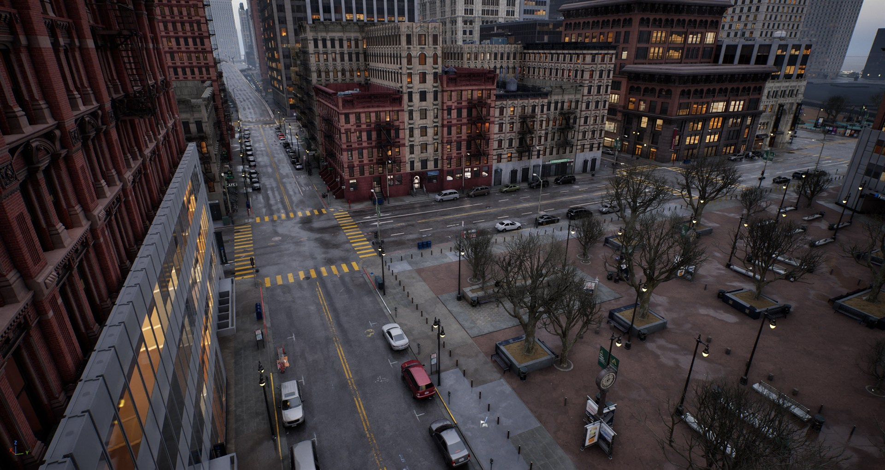

*No outline.*

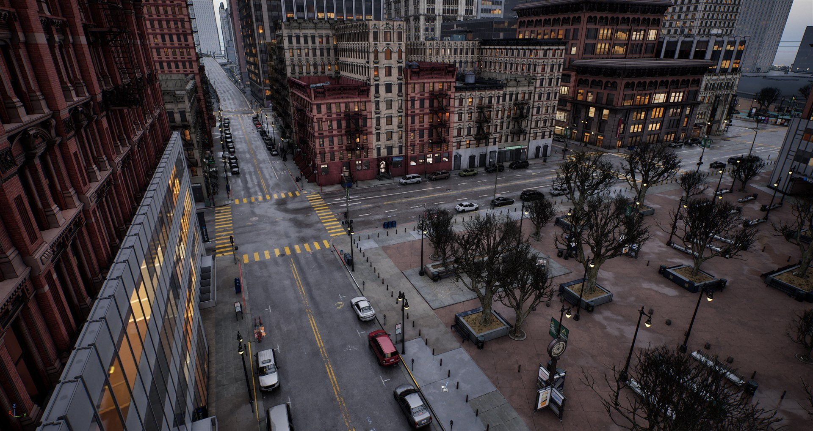

*A plain outline, one rendering pixel wide and blurred in proportion to the screen
percentage. On a scene this dense, a line two display pixels wide darkens
every facade.*

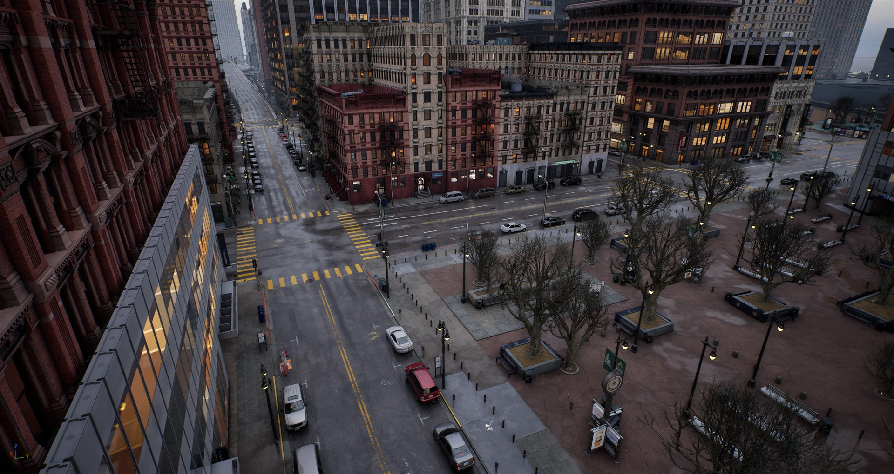

*The thin outline drawn before the upscaler, TSR.*


*The thin outline drawn before the upscaler, DLSS.*

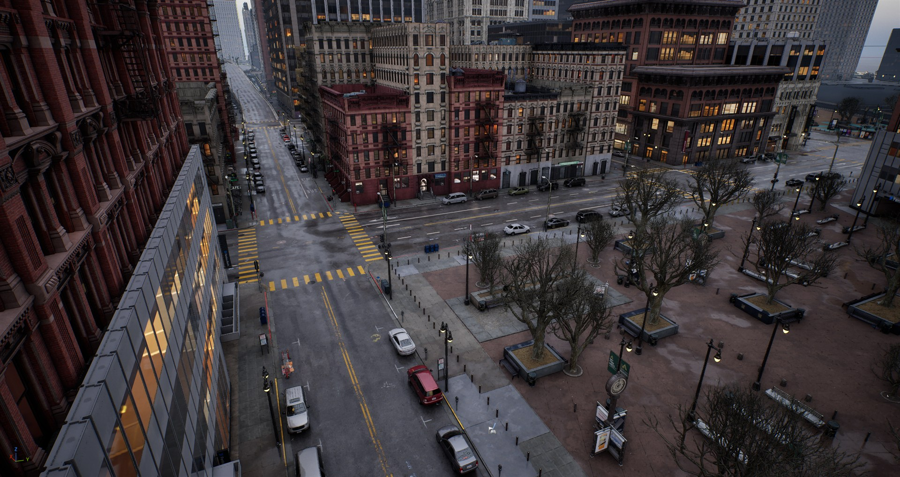

*The thin outline drawn after the upscaler.*

## References

Christoph Schied, Anton Kaplanyan, Chris Wyman, Anjul Patney, Chakravarty
R. Alla Chaitanya, John Burgess, Shiqiu Liu, Carsten Dachsbacher, Aaron
Lefohn, and Marco Salvi. 2017. "Spatiotemporal Variance-Guided Filtering:
Real-Time Reconstruction for Path-Traced Global Illumination." In
*Proceedings of High Performance Graphics (HPG '17)*. ACM.
<https://doi.org/10.1145/3105762.3105770>

## How to Cite

If you reference this work, please cite this post as:

> Donguk Lim. "TAA-Compatible Thin Toon Outlines From G-Buffer Contours."
> *Notes on Rendering* (blog), October 11, 2026.
> <https://donguklim.github.io/rendering/npr/2026/10/11/thin-outline.html>

Or in BibTeX:


```bibtex
@misc{lim2026thinoutlines,
  author       = {Donguk Lim},
  title        = {{TAA}-Compatible Thin Toon Outlines From {G}-Buffer Contours},
  howpublished = {Notes on Rendering (blog)},
  year         = {2026},
  month        = oct,
  url          = {https://donguklim.github.io/rendering/npr/2026/10/11/thin-outline.html}
}
```


The [September post]()
describes the first design and is kept for the record.
